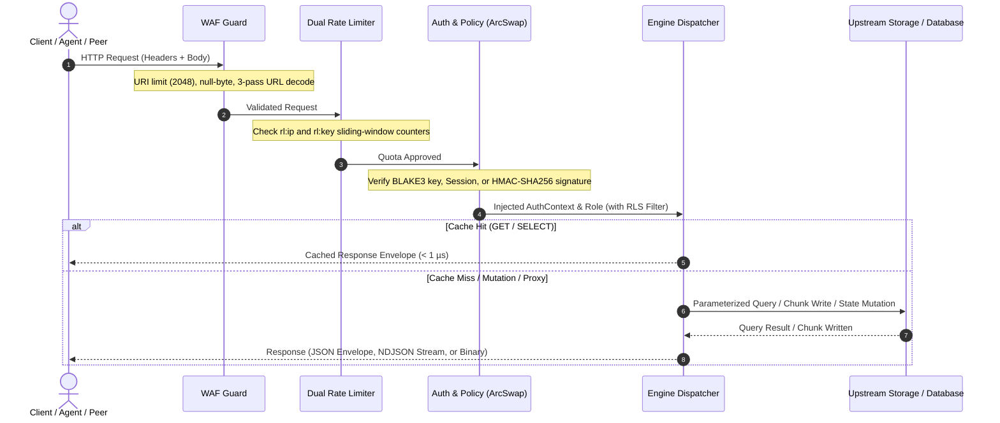

<div align="center">

# Axiom API Reference

### REST Data API, Blob Storage, Admin Control Plane, Cluster Mesh, and MCP Specification

[](https://github.com/toxichome/axiom/releases)
[](https://www.rust-lang.org)
[](../LICENSE)
[](https://github.com/toxichome/axiom/releases)
[](https://modelcontextprotocol.io)

</div>

---

## Architecture & Request Pipeline



---

## Conventions & Envelopes

### Base URL
```text
http://127.0.0.1:4500
```

### Authentication Headers
| Scheme | Header Syntax | Scope | Description |
|---|---|---|---|
| Master API Key | `X-Axiom-Key: <base64(name:secret)>` | Data API (`/api/v1/*`), MCP (`/mcp/v1`) | Machine-to-machine authentication |
| Compatibility Key | `X-Api-Key: <base64(name:secret)>` | Data API (`/api/v1/*`), MCP (`/mcp/v1`) | Legacy gateway compatibility |
| Bearer API Key | `Authorization: Bearer <base64(name:secret)>` | Data API (`/api/v1/*`), MCP (`/mcp/v1`) | Standard OAuth2-style header |
| Admin Session | `Authorization: Bearer <32-char-session-token>` | Admin API (`/admin/v1/*`), Web UI | Token from `POST /admin/v1/auth/login` |
| Inter-Node Signature | `X-Axiom-Signature: <hex(HMAC-SHA256)>` | Cluster Mesh (`/internal/v1/cluster/*`) | Peer-to-peer inter-node signing |
| Capability Ticket | `?ticket=v1.<ns>.<key>.<op>.<exp>.<sig>` | Blob Data API (`/api/v1/blobs/*`) | URL query param for delegated access |

### Response Envelopes

#### Success Envelope (`application/json`)
```json
{
  "success": true,
  "data": { ... },
  "meta": {
    "request_id": "8fa921be-4972-4d2c-8cb4-3010b91e9f1a",
    "duration_ms": 1.42,
    "cached": false
  },
  "error": null
}
```

#### Error Envelope (`application/json`)
```json
{
  "success": false,
  "data": null,
  "meta": {
    "request_id": "8fa921be-4972-4d2c-8cb4-3010b91e9f1a"
  },
  "error": {
    "code": "AUTH_FORBIDDEN",
    "message": "Role 'analyst' lacks INSERT permission on 'main_pg.audit_events'"
  }
}
```

#### Streaming Responses (`application/x-ndjson`)
When `Accept: application/x-ndjson` or `stream: true` is requested on query or rows endpoints, rows are emitted continuously as newline-delimited JSON objects without buffer overhead:
```json
{"id":101,"email":"alice@example.com","status":"active"}
{"id":102,"email":"bob@example.com","status":"active"}
```

---

## 1. Core & System Endpoints

| Method | Endpoint | Auth | Description |
|---|---|---|---|
| `GET` | `/` | Public | Root welcome & liveness probe: `{"status":"ok","name":"axiom"}` |
| `GET` | `/ready` | Public | Upstream database readiness probe (returns `200 OK` or `503 Service Unavailable`) |
| `GET` | `/health` | API Key / Session | System telemetry: server uptime, process memory, database pool statuses |
| `GET` | `/api/v1/health` | Public | Liveness probe mounted under `/api/v1` prefix |
| `GET` | `/metrics` | API Key / Session | Prometheus metrics exposition (`?format=json` for JSON) |
| `GET` | `/system` | Public / Session | Embedded Admin Web UI single-page application |
| `GET` | `/favicon.ico` | Public | Gateway browser favicon |

---

## 2. Database Data API (`/api/v1/db`)

All `/api/v1/db/*` routes require an authenticated API Key (`X-Axiom-Key: base64(name:secret)`).

### Endpoints Summary
| Method | Endpoint | Description |
|---|---|---|
| `GET` | `/api/v1/db/databases` | List database connections accessible by the caller's role |
| `POST` | `/api/v1/db/:alias/query` | Execute parameterized SQL statement via dialect AST firewall |
| `GET` | `/api/v1/db/:alias/tables` | List accessible tables with pagination (`cursor`, `limit`) |
| `GET` | `/api/v1/db/:alias/:table/schema` | Inspect table columns, datatypes, nullability, and foreign keys |
| `GET` | `/api/v1/db/:alias/:table/rows` | Query table rows with keyset pagination, JSON filters, and sorting |
| `POST` | `/api/v1/db/:alias/:table/rows` | Insert one or more rows with `Idempotency-Key` replay protection |
| `PATCH` | `/api/v1/db/:alias/:table/rows` | Update rows matching mandatory filter object |
| `DELETE` | `/api/v1/db/:alias/:table/rows` | Delete rows matching mandatory filter object |
| `POST` | `/api/v1/db/:alias/:table/columns` | Dynamic DDL: Add a column to an existing table schema |

### Querying Data (`POST /api/v1/db/:alias/query`)
```http
POST /api/v1/db/main_pg/query
X-Axiom-Key: <TOKEN>
Content-Type: application/json
```
```json
{
  "query": "SELECT id, email, created_at FROM users WHERE status = $1 ORDER BY id DESC LIMIT 20",
  "params": ["active"],
  "timeout": 10,
  "stream": false
}
```
* **Parameters**:
  * `query` (string, required): Dialect SQL query with positional placeholders (`$1`, `?`, `@P1`).
  * `params` (array, optional): Parameter bindings matching placeholders.
  * `timeout` (integer, optional): Query execution timeout in seconds (default: 30).
  * `stream` (boolean, optional): Stream results line-by-line as `application/x-ndjson`.

### Keyset Row Queries (`GET /api/v1/db/:alias/:table/rows`)
```http
GET /api/v1/db/main_pg/users/rows?limit=25&sort=id&order=desc&filter={"status":{"eq":"active"}}
X-Axiom-Key: <TOKEN>
```
* **Query Parameters**:
  * `filter` (string, optional): URL-encoded JSON filter object.
  * `sort` (string, optional): Column name to sort by (defaults to primary key).
  * `order` (string, optional): Sort direction (`asc` or `desc`, default: `asc`).
  * `limit` (integer, optional): Maximum rows to return (1–10,000, default: 100).
  * `cursor` (integer, optional): Offset cursor for pagination.
  * `stream` (boolean, optional): Return continuous NDJSON stream instead of JSON array.

### Filter Operators Reference
Filters are specified as JSON objects mapping column names to constraint operators:

| Operator | SQL Equivalent | Example JSON Filter |
|---|---|---|
| `eq` | `=` | `{"status": {"eq": "active"}}` |
| `neq` | `!=` | `{"status": {"neq": "banned"}}` |
| `gt` | `>` | `{"score": {"gt": 80}}` |
| `gte` | `>=` | `{"age": {"gte": 21}}` |
| `lt` | `<` | `{"latency_ms": {"lt": 50.0}}` |
| `lte` | `<=` | `{"retry_count": {"lte": 3}}` |
| `like` | `LIKE` | `{"email": {"like": "%@company.com"}}` |
| `ilike` | `ILIKE` / `LOWER(col) LIKE LOWER(?)` | `{"name": {"ilike": "%alice%"}}` |
| `in` | `IN (...)` | `{"role": {"in": ["admin", "editor"]}}` |
| `is_null` | `IS NULL` / `IS NOT NULL` | `{"deleted_at": {"is_null": true}}` |

Logical compound expressions support branching with `$or` and `$and`:
```json
{
  "$or": [
    { "role": { "eq": "admin" } },
    { "$and": [{ "tier": { "eq": "enterprise" } }, { "balance": { "gte": 1000 } }] }
  ]
}
```

### Row-Level Security (RLS)
Roles can define an `rls_filter` on any table permission. The AST engine automatically rewrites queries to inject the constraint predicates into the SQL `WHERE` clause:
```json
{
  "database": "main_pg",
  "table_name": "orders",
  "operations": ["SELECT", "UPDATE"],
  "rls_filter": {
    "tenant_id": { "eq": "tenant_42" },
    "is_deleted": { "eq": false }
  }
}
```

### Mutations (`POST`, `PATCH`, `DELETE`)
* **Insert Rows**: `POST /api/v1/db/:alias/:table/rows` with body `{"rows": [{ "col": "val" }]}`. Accepts `Idempotency-Key` header to prevent duplicate execution on network retry.
* **Update Rows**: `PATCH /api/v1/db/:alias/:table/rows` with body `{"data": { "status": "active" }, "filter": { "id": { "eq": 42 } }}`. Unbounded updates lacking a `filter` are rejected (`400 BAD_REQUEST`).
* **Delete Rows**: `DELETE /api/v1/db/:alias/:table/rows` with body `{"filter": { "status": { "eq": "expired" } }}`. Unbounded deletes lacking a `filter` are rejected (`400 BAD_REQUEST`).
* **Add Column**: `POST /api/v1/db/:alias/:table/columns` with body `{"name": "mfa", "data_type": "BOOLEAN", "nullable": false, "default_value": "false"}`.

---

## 3. Blob Storage Data API (`/api/v1/blobs`)

Content-addressed object storage with automatic BLAKE3 deduplication, byte-range streaming, and capability tickets.

### Endpoints Summary
| Method | Endpoint | Auth | Description |
|---|---|---|---|
| `GET`, `HEAD` | `/api/v1/blobs/public/:namespace/*key` | Public | Unauthenticated direct media CDN fetch with 304 ETag caching |
| `GET` | `/api/v1/blobs/:namespace` | API Key | List stored objects with `prefix`, `cursor`, `limit` |
| `PUT` | `/api/v1/blobs/:namespace/*key` | API Key / Ticket | Upload object with BLAKE3 deduplication and optional `?ttl=...` |
| `GET`, `HEAD` | `/api/v1/blobs/:namespace/*key` | API Key / Ticket | Stream object (supports `Range: bytes=X-Y` and `?ticket=...`) |
| `DELETE` | `/api/v1/blobs/:namespace/*key` | API Key | Delete single object and decrement content refcount |
| `POST` | `/api/v1/blobs/:namespace/delete-objects` | API Key | Batch delete up to 1,000 objects in a single atomic request |
| `POST` | `/api/v1/blobs/:namespace/ticket` | API Key | Mint a pre-signed capability ticket URL |
| `POST` | `/api/v1/blobs/:namespace/uploads` | API Key | Initialize multipart / resumable upload session |
| `PUT` | `/api/v1/blobs/:namespace/uploads/:upload_id/parts/:part` | API Key | Upload discrete part chunk in multipart workflow |
| `POST` | `/api/v1/blobs/:namespace/uploads/:upload_id/complete` | API Key | Complete and atomically assemble multipart upload |
| `PUT`, `PATCH`| `/api/v1/blobs/:namespace/uploads/:upload_id` | API Key | Resumable chunk upload with `Content-Range` header |
| `GET` | `/api/v1/blobs/:namespace/uploads/:upload_id` | API Key | Probe resumable session status and uploaded byte slices |
| `DELETE` | `/api/v1/blobs/:namespace/uploads/:upload_id` | API Key | Abort multipart/resumable upload session and reclaim storage |

### Direct Upload & Download
```bash
# Upload object
curl -X PUT "http://127.0.0.1:4500/api/v1/blobs/media/avatars/user_101.png"   -H "X-Axiom-Key: $KEY"   -H "Content-Type: image/png"   --data-binary "@avatar.png"

# Stream object with byte range seeking (first 1 MB slice)
curl -i "http://127.0.0.1:4500/api/v1/blobs/media/videos/demo.mp4"   -H "X-Axiom-Key: $KEY"   -H "Range: bytes=0-1048575"
```

### Pre-Signed Capability Tickets
Mint a time-bounded signed URL allowing third parties to upload or download without API keys:
```bash
curl -X POST "http://127.0.0.1:4500/api/v1/blobs/media/ticket"   -H "X-Axiom-Key: $KEY"   -H "Content-Type: application/json"   -d '{"key": "reports/q3.pdf", "operation": "READ", "ttl_seconds": 3600}'
```
Response returns signed ticket URL:
`http://127.0.0.1:4500/api/v1/blobs/media/reports/q3.pdf?ticket=v1.media.reports_q3_pdf.READ.1760492800...`

### Resumable Chunked Upload Protocol
For large uploads, initialize a session and stream byte chunks with `Content-Range`:
```bash
# 1. Initialize session
UPLOAD_ID=$(curl -s -X POST "http://127.0.0.1:4500/api/v1/blobs/media/uploads"   -H "X-Axiom-Key: $KEY"   -H "Content-Type: application/json"   -d '{"key": "backup.tar.gz", "content_type": "application/gzip"}' | jq -r '.data.upload_id')

# 2. Upload chunk slice with Content-Range
curl -X PATCH "http://127.0.0.1:4500/api/v1/blobs/media/uploads/$UPLOAD_ID"   -H "X-Axiom-Key: $KEY"   -H "Content-Range: bytes 0-1048575/5242880"   --data-binary "@slice_0.bin"

# 3. Probe session progress
curl -s -H "X-Axiom-Key: $KEY" "http://127.0.0.1:4500/api/v1/blobs/media/uploads/$UPLOAD_ID"
```

---

## 4. Admin Control Plane API (`/admin/v1`)

All `/admin/v1/*` routes (except setup initialization and login) require an administrative session token:
`Authorization: Bearer <32-char-session-token>`.

### Setup & Authentication
| Method | Endpoint | Auth | Request Body / Params | Description |
|---|---|---|---|---|
| `GET`, `POST` | `/admin/v1/setup/begin` | Public | _none_ | Probe if setup is pending; start setup session |
| `POST` | `/admin/v1/setup/account` | Setup | `{"username":"...", "password":"..."}` | Create primary administrative user |
| `POST` | `/admin/v1/setup/database/test` | Setup | `{"engine":"...", "url":"..."}` | Test database URL during setup |
| `POST` | `/admin/v1/setup/database` | Setup | `{"alias":"...", "url":"...", "engine":"..."}` | Add initial database connection |
| `POST` | `/admin/v1/setup/complete` | Setup | _none_ | Complete setup and permanently lock `/setup/*` |
| `POST` | `/admin/v1/auth/login` | Public | `{"username":"...", "password":"..."}` | Authenticate credentials; returns bearer session token |
| `POST` | `/admin/v1/auth/logout` | Session | _none_ | Invalidate active session token |
| `GET` | `/admin/v1/users` | Session | _none_ | Enumerate administrator accounts |

### System & Audit Operations
| Method | Endpoint | Auth | Description |
|---|---|---|---|
| `GET` | `/admin/v1/status` | Session | Gateway overview: connected pools, uptime, cache metrics |
| `POST` | `/admin/v1/reload` | Session | Force instant refresh of in-memory `ArcSwap<Metadata>` snapshot |
| `GET` | `/admin/v1/health` | Session | Administrative health check with storage and pool details |
| `GET` | `/admin/v1/metrics` | Session | System performance metrics in JSON format |
| `GET` | `/admin/v1/audit` | Session | Query control plane mutation audit log (`limit`, `offset`) |

### API Key Management
| Method | Endpoint | Auth | Request Body / Params | Description |
|---|---|---|---|---|
| `GET` | `/admin/v1/keys` | Session | _none_ | Enumerate API keys, assigned roles, and expiration |
| `POST` | `/admin/v1/keys` | Session | `{"name":"...", "role":"...", "secret":"...", "rate_limit":0}` | Generate new API key; returns base64 token |
| `POST` | `/admin/v1/keys/:name/rotate` | Session | _none_ | Atomically roll cryptographic secret for an existing key |
| `DELETE` | `/admin/v1/keys/:name` | Session | _none_ | Revoke and delete API machine key |

### RBAC Role Management
| Method | Endpoint | Auth | Request Body / Params | Description |
|---|---|---|---|---|
| `GET` | `/admin/v1/roles` | Session | _none_ | List all roles and attached permission matrices |
| `POST` | `/admin/v1/roles` | Session | `{"name":"...", "description":"...", "permissions":[...]}` | Create new RBAC role |
| `PATCH` | `/admin/v1/roles/:name` | Session | `{"description":"...", "permissions":[...]}` | Update role permissions or description |
| `DELETE` | `/admin/v1/roles/:name` | Session | _none_ | Delete an RBAC role |

### Database Connection Management
| Method | Endpoint | Auth | Request Body / Params | Description |
|---|---|---|---|---|
| `GET` | `/admin/v1/databases` | Session | _none_ | List configured database connections and pool status |
| `POST` | `/admin/v1/databases` | Session | `{"alias":"...", "url":"...", "engine":"...", "mode":"..."}` | Register new upstream database connection |
| `POST` | `/admin/v1/databases/test-url` | Session | `{"engine":"...", "url":"..."}` | Test connectivity to raw URL before saving |
| `GET` | `/admin/v1/databases/:alias/test` | Session | _none_ | Probe connection and measure ping latency for an alias |
| `DELETE` | `/admin/v1/databases/:alias` | Session | _none_ | Deregister and remove database connection |

### Cache Management
| Method | Endpoint | Auth | Description |
|---|---|---|---|
| `GET` | `/admin/v1/cache/stats` | Session | Inspect L1 RAM and L2 cache memory, entries, and hit ratio |
| `POST` | `/admin/v1/cache/flush` | Session | Atomically flush all volatile cache entries |

### Cluster Mesh Control Plane
| Method | Endpoint | Auth | Request Body / Params | Description |
|---|---|---|---|---|
| `GET` | `/admin/v1/cluster/status` | Session | _none_ | Get local node ID, moniker, cluster secret, and peer counts |
| `GET` | `/admin/v1/cluster/peers` | Session | _none_ | List registered cluster peers, latency RTT, and health status |
| `POST` | `/admin/v1/cluster/peers` | Session | `{"url":"...", "secret":"...", "moniker":"..."}` | Connect and pair remote peer node |
| `PATCH` | `/admin/v1/cluster/peers/:node_id` | Session | `{"moniker":"...", "url":"...", "secret":"..."}` | Update peer connection configuration |
| `DELETE` | `/admin/v1/cluster/peers/:node_id` | Session | _none_ | Disconnect and remove peer from cluster |
| `POST` | `/admin/v1/cluster/peers/:node_id/ping` | Session | _none_ | Dispatch on-demand heartbeat latency probe to peer |
| `PATCH` | `/admin/v1/cluster/moniker` | Session | `{"moniker":"..."}` | Update local node display moniker |

### Blob Storage Administration (`/admin/v1/blobs`)
| Method | Endpoint | Auth | Request Body / Params | Description |
|---|---|---|---|---|
| `GET` | `/admin/v1/blobs/stats` | Session | _none_ | Storage-wide telemetry: bytes used, dedup savings, objects |
| `POST` | `/admin/v1/blobs/scrub` | Session | _none_ | Background storage-wide BLAKE3 integrity check |
| `POST` | `/admin/v1/blobs/sweep` | Session | _none_ | Manually trigger expired object TTL cleanup |
| `GET` | `/admin/v1/blobs/namespaces` | Session | _none_ | Enumerate storage namespaces, quotas, and public read state |
| `POST` | `/admin/v1/blobs/namespaces` | Session | `{"name":"...", "max_bytes":0, "public_read":false}` | Create storage namespace with quota ceiling |
| `PATCH` | `/admin/v1/blobs/namespaces/:ns` | Session | `{"max_bytes":0, "public_read":true}` | Update namespace quota or toggle public access |
| `DELETE` | `/admin/v1/blobs/namespaces/:ns` | Session | _none_ | Delete namespace and purge stored objects |
| `POST` | `/admin/v1/blobs/copy` | Session | `{"src_namespace":"..", "src_key":"..", "dest_namespace":"..", "dest_key":".."}` | Copy object or prefix |
| `POST` | `/admin/v1/blobs/move` | Session | `{"src_namespace":"..", "src_key":"..", "dest_namespace":"..", "dest_key":".."}` | Move/rename object or prefix |
| `POST` | `/admin/v1/blobs/delete-prefix` | Session | `{"namespace":"...", "prefix":"..."}` | Bulk delete all objects matching prefix |
| `POST` | `/admin/v1/blobs/verify/:ns/*key` | Session | _none_ | Verify on-disk checksum integrity for single blob |
| `GET` | `/admin/v1/blobs/tickets` | Session | _none_ | Enumerate active capability tickets |
| `POST` | `/admin/v1/blobs/tickets/:sig/revoke` | Session | _none_ | Revoke capability ticket before expiration |
| `DELETE` | `/admin/v1/blobs/tickets/:sig` | Session | _none_ | Delete capability ticket |

---

## 5. Cluster Mesh Internal P2P Protocol (`/internal/v1/cluster`)

Internal inter-node coordination endpoints protected by mutual HMAC-SHA256 authentication.

### Mandatory Inter-Node Headers
* `X-Axiom-Node-ID`: The sender node's unique cluster ID.
* `X-Axiom-Timestamp`: Unix millisecond timestamp (rejected if clock drift exceeds ±30s).
* `X-Axiom-Signature`: Hex-encoded `HMAC-SHA256(cluster_secret, timestamp + body)`.

### Endpoints
| Method | Endpoint | Description |
|---|---|---|
| `POST` | `/internal/v1/cluster/handshake` | P2P mutual authentication and public URL/moniker verification |
| `GET` | `/internal/v1/cluster/ping` | Inter-node heartbeat latency probe |
| `POST` | `/internal/v1/cluster/event` | Gossip event broadcast (instant security auto-ban propagation) |
| `GET` | `/internal/v1/cluster/sync` | Full cluster mesh peer state synchronization |

#### Auto-Ban Gossip Payload (`POST /internal/v1/cluster/event`)
```json
{
  "event_type": "security_ban",
  "source_node": "node_7f1a3b8c9d0e",
  "payload": {
    "ip": "198.51.100.42",
    "reason": "rate_limit_penalty_threshold_exceeded",
    "duration_seconds": 300
  }
}
```

---

## 6. Model Context Protocol (MCP) (`POST /mcp/v1`)

JSON-RPC 2.0 Model Context Protocol endpoint for AI coding assistants (Claude Code, Cursor, Copilot, Windsurf). Requires API key or session token.

### 15 Native Tools
| Category | Tool Name | Parameters | Description |
|---|---|---|---|
| **Database** | `axiom_list_services` | _none_ | List accessible database aliases |
| | `axiom_list_tables` | `service` | List tables in target database |
| | `axiom_describe_table` | `service`, `table` | Return columns, datatypes, and foreign keys |
| | `axiom_query` | `service`, `table`, `filter`, `limit` | Query rows via structured filter object |
| | `axiom_insert` | `service`, `table`, `rows` | Insert rows into table |
| | `axiom_update` | `service`, `table`, `filter`, `data` | Update rows matching mandatory filter |
| | `axiom_delete` | `service`, `table`, `filter` | Delete rows matching mandatory filter |
| | `axiom_raw_sql` | `service`, `query`, `params` | Execute single SQL statement via AST firewall |
| **Blob** | `axiom_list_blob_namespaces` | _none_ | List configured blob storage namespaces |
| | `axiom_list_blobs` | `namespace`, `prefix`, `limit` | Enumerate objects with prefix filtering |
| | `axiom_get_blob_metadata` | `namespace`, `key` | Retrieve object size, MIME type, and BLAKE3 hash |
| | `axiom_read_blob` | `namespace`, `key` | Read blob text or base64 binary (5 MB cap) |
| | `axiom_write_blob` | `namespace`, `key`, `content`, `content_type` | Write blob payload directly from agent context |
| | `axiom_delete_blob` | `namespace`, `key` | Delete object from namespace |
| | `axiom_create_download_ticket` | `namespace`, `key`, `ttl_seconds` | Mint pre-signed URL for client download |

### 5 Context Resources
| Resource URI | Description | MIME Type |
|---|---|---|
| `axiom://schema/{alias}` | DDL schema dump for a database | `application/json` |
| `axiom://telemetry` | Connection pool health and status | `application/json` |
| `axiom://cache/stats` | L1 RAM cache hit/miss and memory utilization | `application/json` |
| `axiom://blobs/{namespace}` | Summary of namespace objects | `application/json` |
| `axiom://blobs/{namespace}/stats` | Storage utilization and deduplication ratio | `application/json` |

---

## 7. Error Codes & HTTP Status Mapping

| Error Code | HTTP Status | Root Cause | Remediation |
|---|---|---|---|
| `WAF_URI_TOO_LONG` | 414 | Request URI exceeds 2,048 bytes | Move complex filter expressions from query string to `POST` body |
| `WAF_NULL_BYTE` | 400 | Null byte (`%00`) detected in path or query | Strip null byte character sequences from input |
| `WAF_PATH_TRAVERSAL` | 400 | Path traversal sequence (`..`) detected after 3-pass decode | Provide normalized, clean keys without relative directory components |
| `WAF_BODY_TOO_LARGE` | 413 | Payload exceeds configured `body_limit` | Stream using multipart upload API or raise `body_limit` in `config.toml` |
| `RATE_LIMIT_EXCEEDED` | 429 | Exceeded requests-per-minute quota on IP or Key | Throttle request rate; inspect `X-RateLimit-Reset` header |
| `BANNED` | 403 | IP or Key auto-banned after consecutive auth failures | Wait for penalty cooldown (default: 300s) or rotate key |
| `AUTH_INVALID` | 401 | Missing, malformed, or invalid credentials | Supply valid `base64(name:secret)` or active bearer session token |
| `AUTH_FORBIDDEN` | 403 | Caller lacks permission for `(database, table, operation)` | Update role permissions via Admin Web UI or CLI (`axiom role update`) |
| `RLS_VIOLATION` | 403 | Operation violates Row-Level Security predicate filter | Verify caller role permissions and assigned `rls_filter` constraints |
| `STORAGE_QUOTA_EXCEEDED` | 413 | Target blob namespace reached `max_bytes` capacity | Increase namespace quota via `axiom blob ns update` or delete objects |
| `MULTI_STATEMENT_DENIED` | 400 | SQL query contains semicolons or stacked statements | Send exactly one SQL statement per request |
| `RANGE_NOT_SATISFIABLE` | 416 | Byte range offset exceeds file size or 256 MB slice | Request a valid single byte range slice (`Range: bytes=0-1048575`) |
| `DB_NOT_FOUND` | 404 | Database alias does not exist | Verify alias spelling or register connection via `axiom db add` |
| `SQL_PARSE_ERROR` | 400 | SQL statement rejected by AST parser | Verify query matches target dialect and parameter syntax (`$1`, `?`, `@P1`) |
| `CLUSTER_PEER_UNREACHABLE` | 502 | Target cluster mesh node is offline or unreachable | Verify peer URL, firewall settings, and target port reachability |
| `CLUSTER_AUTH_FAILED` | 401 | Inter-node HMAC-SHA256 signature mismatch or drift | Ensure system clocks are synchronized and cluster secrets match |
| `CLUSTER_HANDSHAKE_ERROR` | 400 | Remote node rejected cluster pairing handshake | Confirm remote node is running compatible Axiom version and secret |

---

Maintained by [Toxichome](https://toxichome.cc). Licensed under the [MIT License](../LICENSE).
