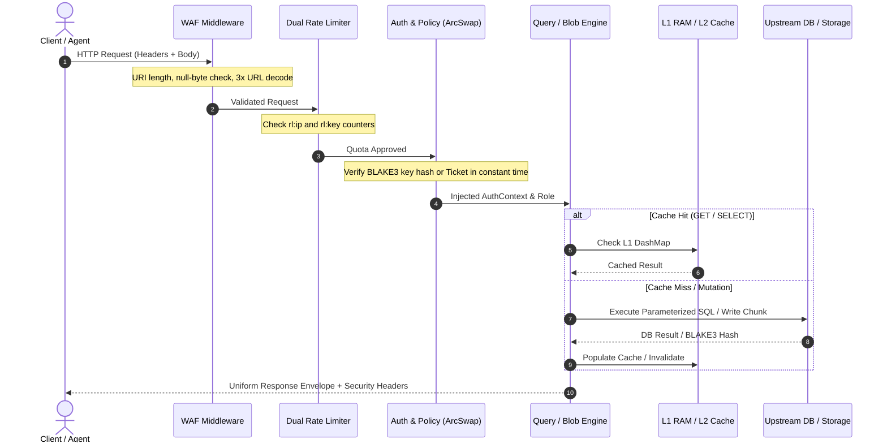
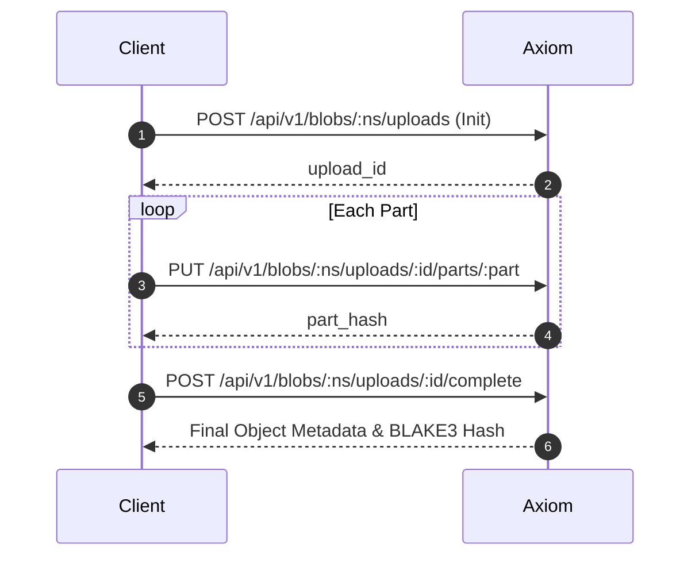

<div align="center">

# Axiom API Reference

### Complete REST, Blob Storage, Capability Tickets, and MCP Protocol Specification
**High-performance SQL Gateway · Content-Addressed Object Store · AI Agent Server**

[](https://github.com/toxichome/axiom/releases)
[](https://www.rust-lang.org)
[](../LICENSE)
[](https://github.com/toxichome/axiom/releases)
[](https://modelcontextprotocol.io)

</div>

---

## Architecture & Request Lifecycle

Every inbound request to Axiom passes through an ordered, deterministic pipeline before hitting upstream database connection pools or the content-addressed blob engine:



---

## Global Invariants & Headers

### Base URL
```text
http://127.0.0.1:4500
```

### Authentication Schemes
All requests (except public `/health`, `/ready`, and pre-signed capability ticket URLs) require valid caller credentials.

| Scheme | Header Syntax | Description |
|---|---|---|
| Master API Key | `X-Axiom-Key: <base64(name:secret)>` | Standard programmatic authentication for services and applications |
| Alternative Header | `X-Api-Key: <base64(name:secret)>` | Compatibility header for legacy API gateways and proxies |
| Bearer API Key | `Authorization: Bearer <base64(name:secret)>` | Standard OAuth2-style header accepting base64 API key credentials |
| Admin Session | `Authorization: Bearer <32-char-session-token>` | Session token generated via Web UI console login (`/admin/v1/auth/login`) |
| Pre-Signed Ticket | `?ticket=v1.<ns>.<key>.<op>.<exp>.<sig>` | URL query parameter for zero-credential download/upload delegation |

> [!NOTE]
> Key validation executes via constant-time XOR comparison against an in-memory `ArcSwap<Metadata>` snapshot. Data requests never touch SQLite metadata tables on the hot path.

### Standard Response Envelope
All API endpoints return a uniform JSON envelope format:

```json
{
  "success": true,
  "data": {
    "rows": [
      { "id": 101, "name": "App Signal", "status": "active" }
    ],
    "rows_affected": 0,
    "columns": ["id", "name", "status"]
  },
  "error": null,
  "meta": {
    "request_id": "8fa921be-4972-4d2c-8cb4-3010b91e9f1a",
    "duration_ms": 1.42,
    "cached": false
  }
}
```

### Standard Error Envelope
When a request fails, `success` is `false`, `data` is `null`, and `error` contains structured diagnosis:

```json
{
  "success": false,
  "data": null,
  "error": {
    "code": "RATE_LIMIT_EXCEEDED",
    "message": "Rate limit quota exceeded for key or source IP."
  },
  "meta": {
    "request_id": "8fa921be-4972-4d2c-8cb4-3010b91e9f1a",
    "duration_ms": 0.31,
    "cached": false
  }
}
```

### Response Headers
Every response includes security and telemetry metadata:
- `X-Request-ID`: UUID v4 unique to each request cycle
- `X-RateLimit-Limit`: Maximum requests permitted per rate window
- `X-RateLimit-Remaining`: Remaining request quota in current window
- `X-RateLimit-Reset`: Seconds remaining until quota refresh
- `X-Idempotency-Hit: true`: Injected when serving an idempotent mutation replay
- `X-Content-Type-Options: nosniff`
- `X-Frame-Options: DENY`
- `Strict-Transport-Security: max-age=63072000; includeSubDomains; preload`
- `Content-Security-Policy: default-src 'none'; frame-ancestors 'none';`

---

## Core & System Endpoints

### 1. Health Liveness Probe
```http
GET /health
```
Public liveness probe returning immediately without acquiring database connections.

```bash
curl -s http://127.0.0.1:4500/health
```

```json
{
  "status": "ok",
  "version": "0.1.11"
}
```

### 2. Readiness Connectivity Probe
```http
GET /ready
```
Verifies active network connectivity across all configured upstream database pools.

```bash
curl -s -i http://127.0.0.1:4500/ready
```

Returns `HTTP 200 OK` when all pools are reachable, or `HTTP 503 Service Unavailable` if an essential database is disconnected.

### 3. Prometheus Metrics
```http
GET /metrics
```
Exposes system, pool, cache, and HTTP telemetry. Supports standard Prometheus text format and JSON serialization.

```bash
curl -s -H "Authorization: Bearer $ADMIN_SESSION" "http://127.0.0.1:4500/metrics?format=json"
```

---

## Database Data API (`/api/v1/db`)

### 1. Enumerate Databases
```http
GET /api/v1/db/databases
```
Returns all database aliases configured on the gateway that the caller's role is authorized to access.

```bash
curl -s -H "X-Axiom-Key: $KEY" http://127.0.0.1:4500/api/v1/db/databases
```

```json
{
  "success": true,
  "data": [
    {
      "name": "main_pg",
      "engine": "postgres",
      "mode": "read_write",
      "status": "online",
      "tables_count": 42
    },
    {
      "name": "analytics_ch",
      "engine": "clickhouse",
      "mode": "read_only",
      "status": "online",
      "tables_count": 18
    }
  ],
  "error": null,
  "meta": { "request_id": "3c7b88aa-1234-4567-89ab-cdef01234567", "duration_ms": 0.85, "cached": false }
}
```

---

### 2. Raw Parameterized SQL
```http
POST /api/v1/db/:alias/query
Content-Type: application/json
```

Executes a single parameterized SQL statement through the dialect-aware AST firewall. Multi-statement chains (`SELECT 1; DROP TABLE users;`) are strictly blocked.

#### Request Parameters
| Field | Type | Required | Description |
|---|---|---|---|
| `query` | string | Yes | Dialect SQL query with parameter place-holders (`$1`, `?`, `@P1`) |
| `params` | array \| object | No | Positional array (`["active", 100]`) or named parameter map |
| `timeout` | integer | No | Query execution timeout in seconds (1–300, default: 30) |

```bash
curl -s -X POST http://127.0.0.1:4500/api/v1/db/main_pg/query \
  -H "X-Axiom-Key: $KEY" \
  -H "Idempotency-Key: 7f83b165-7eae-4f49-9cf9-e93237590827" \
  -H "Content-Type: application/json" \
  -d '{
    "query": "SELECT id, email, created_at FROM users WHERE status = $1 ORDER BY id DESC LIMIT 2",
    "params": ["active"],
    "timeout": 10
  }'
```

```json
{
  "success": true,
  "data": {
    "rows": [
      { "id": 102, "email": "carol@example.com", "created_at": "2026-10-14T18:22:00Z" },
      { "id": 101, "email": "alice@example.com", "created_at": "2026-10-14T17:15:30Z" }
    ],
    "rows_affected": 0,
    "columns": ["id", "email", "created_at"]
  },
  "error": null,
  "meta": { "request_id": "4e11a2bc-5678-4321-abcd-ef0123456789", "duration_ms": 1.25, "cached": false }
}
```

> [!TIP]
> Supply an `Idempotency-Key` header on write mutations (`INSERT`, `UPDATE`, `DELETE`). Axiom caches the mutation result for 24 hours in L2 storage to guarantee safe network retries.

---

### 3. List Tables
```http
GET /api/v1/db/:alias/tables?cursor=0&limit=50
```
Returns a paginated list of accessible tables with structural metadata.

```bash
curl -s -H "X-Axiom-Key: $KEY" "http://127.0.0.1:4500/api/v1/db/main_pg/tables?limit=2"
```

```json
{
  "success": true,
  "data": {
    "tables": [
      { "name": "accounts", "engine": "postgres", "estimated_rows": 1420 },
      { "name": "users", "engine": "postgres", "estimated_rows": 8500 }
    ],
    "total": 42,
    "cursor": 2,
    "has_more": true
  },
  "error": null,
  "meta": { "request_id": "90ab12cd-ef34-5678-90ab-cdef12345678", "duration_ms": 0.92, "cached": false }
}
```

---

### 4. Inspect Table Schema & Relations
```http
GET /api/v1/db/:alias/:table/schema
```
Introspects table columns, data types, nullability constraints, default expressions, and foreign key relations.

```bash
curl -s -H "X-Axiom-Key: $KEY" http://127.0.0.1:4500/api/v1/db/main_pg/users/schema
```

```json
{
  "success": true,
  "data": {
    "table": "users",
    "columns": [
      { "name": "id", "data_type": "BIGINT", "nullable": false, "primary_key": true, "default_value": "nextval('users_id_seq')" },
      { "name": "email", "data_type": "VARCHAR(255)", "nullable": false, "primary_key": false, "default_value": null },
      { "name": "status", "data_type": "VARCHAR(32)", "nullable": false, "primary_key": false, "default_value": "'active'" }
    ],
    "foreign_keys": [
      { "column": "org_id", "foreign_table": "organizations", "foreign_column": "id" }
    ]
  },
  "error": null,
  "meta": { "request_id": "b1234567-cdef-8901-2345-67890abcdef0", "duration_ms": 1.10, "cached": true }
}
```

---

### 5. Fetch Rows (Structured Table Queries)
```http
GET /api/v1/db/:alias/:table/rows
```

Keyset-paginated row queries with composable JSON filtering and sorting.

#### Query String Parameters
| Parameter | Type | Default | Description |
|---|---|---|---|
| `filter` | JSON (URL-encoded) | `{}` | Column predicate constraint mapping |
| `sort` | string | primary key | Column to sort by |
| `order` | string | `asc` | Direction: `asc` or `desc` |
| `limit` | integer | 100 | Rows to return (1–10,000) |
| `cursor` | integer | 0 | Keyset cursor offset |

```bash
curl -s -G http://127.0.0.1:4500/api/v1/db/main_pg/users/rows \
  -H "X-Axiom-Key: $KEY" \
  --data-urlencode 'filter={"status":{"eq":"active"},"score":{"gte":80}}' \
  --data-urlencode 'sort=id' \
  --data-urlencode 'order=desc' \
  --data-urlencode 'limit=25'
```

#### Supported Filter Operators
| Operator | SQL Equivalent | Example JSON Filter |
|---|---|---|
| `eq` | `=` | `{"status": {"eq": "active"}}` |
| `neq` | `!=` | `{"status": {"neq": "archived"}}` |
| `gt` | `>` | `{"score": {"gt": 80}}` |
| `gte` | `>=` | `{"age": {"gte": 21}}` |
| `lt` | `<` | `{"latency_ms": {"lt": 50.0}}` |
| `lte` | `<=` | `{"retry_count": {"lte": 3}}` |
| `like` | `LIKE` | `{"email": {"like": "%@company.com"}}` |
| `in` | `IN (...)` | `{"role": {"in": ["admin", "developer"]}}` |
| `is_null` | `IS NULL` / `IS NOT NULL` | `{"deleted_at": {"is_null": true}}` |

---

### 6. Insert Rows
```http
POST /api/v1/db/:alias/:table/rows
Content-Type: application/json
```

Inserts one or more row objects in a single batch.

```bash
curl -s -X POST http://127.0.0.1:4500/api/v1/db/main_pg/users/rows \
  -H "X-Axiom-Key: $KEY" \
  -H "Content-Type: application/json" \
  -d '{
    "rows": [
      { "email": "dev1@example.com", "status": "active" },
      { "email": "dev2@example.com", "status": "pending" }
    ]
  }'
```

```json
{
  "success": true,
  "data": {
    "rows_affected": 2,
    "inserted_ids": [103, 104]
  },
  "error": null,
  "meta": { "request_id": "cdef0123-4567-89ab-cdef-0123456789ab", "duration_ms": 2.15, "cached": false }
}
```

---

### 7. Scoped Row Updates
```http
PATCH /api/v1/db/:alias/:table/rows
Content-Type: application/json
```

Updates records matching a mandatory filter object. Unbounded updates lacking a filter are rejected with `400 BAD_REQUEST`.

```bash
curl -s -X PATCH http://127.0.0.1:4500/api/v1/db/main_pg/users/rows \
  -H "X-Axiom-Key: $KEY" \
  -H "Content-Type: application/json" \
  -d '{
    "data": { "status": "suspended" },
    "filter": { "failed_attempts": { "gte": 5 } }
  }'
```

```json
{
  "success": true,
  "data": {
    "rows_affected": 3
  },
  "error": null,
  "meta": { "request_id": "d0123456-789a-bcde-f012-3456789abcde", "duration_ms": 1.74, "cached": false }
}
```

---

### 8. Scoped Row Deletions
```http
DELETE /api/v1/db/:alias/:table/rows
Content-Type: application/json
```

Deletes records matching a mandatory filter object. Unbounded deletions lacking a filter are blocked.

```bash
curl -s -X DELETE http://127.0.0.1:4500/api/v1/db/main_pg/users/rows \
  -H "X-Axiom-Key: $KEY" \
  -H "Content-Type: application/json" \
  -d '{
    "filter": { "status": { "eq": "expired" } }
  }'
```

---

### 9. Dynamic DDL (Add Table Column)
```http
POST /api/v1/db/:alias/:table/columns
Content-Type: application/json
```

Safely appends a new column to an existing table schema.

```bash
curl -s -X POST http://127.0.0.1:4500/api/v1/db/main_pg/users/columns \
  -H "X-Axiom-Key: $KEY" \
  -H "Content-Type: application/json" \
  -d '{
    "name": "mfa_enabled",
    "data_type": "BOOLEAN",
    "nullable": false,
    "default_value": "false"
  }'
```

---

## Blob Storage Data API (`/api/v1/blobs`)

Axiom includes an integrated content-addressed blob engine with inline LSM storage for objects `<= 64 KB` and sharded disk storage for larger payloads. Content deduplication is automated using BLAKE3 cryptographic hashes.

### 1. Upload Object
```http
PUT /api/v1/blobs/:namespace/*key
Content-Type: <media-type>
```

```bash
curl -s -X PUT "http://127.0.0.1:4500/api/v1/blobs/media/avatars/user_101.png" \
  -H "X-Axiom-Key: $KEY" \
  -H "Content-Type: image/png" \
  --data-binary "@avatar.png"
```

```json
{
  "success": true,
  "data": {
    "key": "avatars/user_101.png",
    "hash": "8f434346648f6b96df89dda901c5176b10a6d83961dd3c1ac88b59b2dc327aa4",
    "size": 48201,
    "content_type": "image/png"
  },
  "error": null,
  "meta": { "request_id": "e1234567-89ab-cdef-0123-456789abcdef", "duration_ms": 3.40, "cached": false }
}
```

---

### 2. Stream Object & Byte Range Requests
```http
GET /api/v1/blobs/:namespace/*key
```

Supports single byte range slices up to 256 MB for video seeking and resumable downloads:

```bash
# Full download
curl -s -H "X-Axiom-Key: $KEY" \
  "http://127.0.0.1:4500/api/v1/blobs/media/videos/demo.mp4" -o demo.mp4

# Resumable partial chunk download (first 1 MB)
curl -s -i -H "X-Axiom-Key: $KEY" \
  -H "Range: bytes=0-1048575" \
  "http://127.0.0.1:4500/api/v1/blobs/media/videos/demo.mp4" -o chunk.bin
```

Response returns `HTTP 206 Partial Content` with standard range headers:
```http
HTTP/1.1 206 Partial Content
Content-Type: video/mp4
Content-Range: bytes 0-1048575/14205820
Content-Length: 1048576
ETag: "8f434346648f6b96df89dda901c5176b10a6d83961dd3c1ac88b59b2dc327aa4"
```

---

### 3. Public Direct Media & Static CDN Caching
```http
GET /api/v1/blobs/public/:namespace/*key
```

When a namespace has **Public Read Access** enabled, any client or browser can fetch objects directly without an `X-Axiom-Key` header or pre-signed ticket. This endpoint is optimized for static website assets (``, `<video>`, CSS, JS, documents) with aggressive browser caching and zero CPU authentication overhead on the hot path.

```bash
# Direct fetch from any browser or CDN (no auth required)
curl -s -i "http://127.0.0.1:4500/api/v1/blobs/public/media/avatars/user_101.png"
```

Response includes standard caching headers:
```http
HTTP/1.1 200 OK
Content-Type: image/png
Content-Length: 48201
ETag: "8f434346648f6b96df89dda901c5176b10a6d83961dd3c1ac88b59b2dc327aa4"
Cache-Control: public, max-age=31536000, immutable
Access-Control-Allow-Origin: *
```

#### Conditional 304 Caching (`If-None-Match`)
Browsers caching the asset will send the `If-None-Match` header on subsequent page loads. Axiom responds with `304 Not Modified` without re-transmitting the payload body:

```bash
curl -s -i "http://127.0.0.1:4500/api/v1/blobs/public/media/avatars/user_101.png" \
  -H 'If-None-Match: "8f434346648f6b96df89dda901c5176b10a6d83961dd3c1ac88b59b2dc327aa4"'
```

```http
HTTP/1.1 304 Not Modified
ETag: "8f434346648f6b96df89dda901c5176b10a6d83961dd3c1ac88b59b2dc327aa4"
Cache-Control: public, max-age=31536000, immutable
```

> [!NOTE]
> Public Read Access only permits unauthenticated `GET` and `HEAD` requests. Mutation operations (`PUT`, `DELETE`, `POST`) remain strictly protected by API key authentication and RBAC policies. If public access is disabled on a namespace, requests to `/api/v1/blobs/public/...` return `403 Forbidden`.

---

### 4. Retrieve Object Metadata
```http
HEAD /api/v1/blobs/:namespace/*key
```

Returns object headers (`Content-Type`, `Content-Length`, `ETag`, `X-Axiom-Hash`) without transmitting the payload body.

---

### 5. Delete Object
```http
DELETE /api/v1/blobs/:namespace/*key
```

Removes the key reference from the namespace and decrements the internal BLAKE3 content refcount.

> [!NOTE]
> Capability tickets cannot execute deletions. Deleting objects always requires an authenticated master API key holding `DELETE` permissions.

---

### 6. Batch Delete Objects
```http
POST /api/v1/blobs/:namespace/delete-objects
Content-Type: application/json
```

Deletes up to 1,000 object keys from a namespace in a single atomic request. Requires an authenticated API key with `DELETE` permission on the target namespace.

```bash
curl -s -X POST "http://127.0.0.1:4500/api/v1/blobs/media/delete-objects" \
  -H "X-Axiom-Key: $KEY" \
  -H "Content-Type: application/json" \
  -d '{
    "keys": [
      "avatars/user_101.png",
      "avatars/user_102.png",
      "temp/cached_file.tmp"
    ]
  }'
```

```json
{
  "success": true,
  "data": {
    "deleted": [
      "avatars/user_101.png",
      "avatars/user_102.png",
      "temp/cached_file.tmp"
    ],
    "errors": []
  },
  "error": null,
  "meta": { "request_id": "a1b2c3d4-e5f6-7890-abcd-ef1234567890", "duration_ms": 1.12, "cached": false }
}
```

---

### 7. List Blobs by Prefix
```http
GET /api/v1/blobs/:namespace?prefix=avatars/&limit=50&cursor=0
```

```json
{
  "success": true,
  "data": {
    "objects": [
      {
        "key": "avatars/user_101.png",
        "hash": "8f434346648f6b96df89dda901c5176b10a6d83961dd3c1ac88b59b2dc327aa4",
        "size": 48201,
        "content_type": "image/png",
        "created_at": 1760492800
      }
    ],
    "total": 1,
    "has_more": false
  },
  "error": null,
  "meta": { "request_id": "f2345678-9abc-def0-1234-56789abcdef0", "duration_ms": 0.88, "cached": false }
}
```

---

### 8. Multipart Upload Workflow (Large Files)

For reliable uploads of large objects (up to 5 GB), Axiom provides a 4-step multipart session workflow:



#### Step 1: Initialize Upload
```http
POST /api/v1/blobs/:namespace/uploads
Content-Type: application/json
```
```bash
curl -s -X POST "http://127.0.0.1:4500/api/v1/blobs/media/uploads" \
  -H "X-Axiom-Key: $KEY" \
  -H "Content-Type: application/json" \
  -d '{"key": "backups/archive.tar.gz", "content_type": "application/gzip"}'
```
Returns `{"upload_id": "up_7f1a3b8c9d0e"}`.

#### Step 2: Upload Discrete Parts
```http
PUT /api/v1/blobs/:namespace/uploads/:upload_id/parts/:part_number
```
```bash
curl -s -X PUT "http://127.0.0.1:4500/api/v1/blobs/media/uploads/up_7f1a3b8c9d0e/parts/1" \
  -H "X-Axiom-Key: $KEY" \
  --data-binary "@part_01.bin"
```

#### Step 3: Complete & Assemble Upload
```http
POST /api/v1/blobs/:namespace/uploads/:upload_id/complete
Content-Type: application/json
```
```bash
curl -s -X POST "http://127.0.0.1:4500/api/v1/blobs/media/uploads/up_7f1a3b8c9d0e/complete" \
  -H "X-Axiom-Key: $KEY" \
  -H "Content-Type: application/json" \
  -d '{"parts": [1, 2, 3]}'
```

#### Step 4: Abort Upload (Optional)
```http
DELETE /api/v1/blobs/:namespace/uploads/:upload_id
```
Discards all buffered parts and reclaims temporary disk space.

---

## Pre-Signed Capability Tickets

Capability tickets grant time-bounded, single-object `READ` or `WRITE` access to third parties without exposing your master API credentials.

### Mint Capability Ticket
```http
POST /api/v1/blobs/:namespace/ticket
Content-Type: application/json
```

```bash
curl -s -X POST "http://127.0.0.1:4500/api/v1/blobs/media/ticket" \
  -H "X-Axiom-Key: $KEY" \
  -H "Content-Type: application/json" \
  -d '{
    "key": "avatars/user_101.png",
    "operation": "READ",
    "ttl_seconds": 3600
  }'
```

```json
{
  "success": true,
  "data": {
    "ticket": "v1.media.avatars_user_101_png.READ.1760492800.7f1a3b8c9d0e1f2a3b4c5d6e7f8a9b0c",
    "url": "http://127.0.0.1:4500/api/v1/blobs/media/avatars/user_101.png?ticket=v1.media.avatars_user_101_png.READ.1760492800.7f1a3b8c9d0e1f2a3b4c5d6e7f8a9b0c"
  },
  "error": null,
  "meta": { "request_id": "01234567-89ab-cdef-0123-456789abcdef", "duration_ms": 0.42, "cached": false }
}
```

The client accesses the file without any headers:
```bash
curl -s "http://127.0.0.1:4500/api/v1/blobs/media/avatars/user_101.png?ticket=v1.media..." -o avatar.png
```

---

## Model Context Protocol (MCP) (`POST /mcp/v1`)

Axiom exposes a standardized JSON-RPC 2.0 endpoint at `/mcp/v1` allowing LLM coding assistants (Claude Code, Cursor, Copilot, Windsurf) to securely inspect schemas, query databases, and read/write blobs.

### Available MCP Tools (15 Tools)

#### Database Tools
| Tool Name | Parameters | Description |
|---|---|---|
| `axiom_list_services` | *(none)* | List all accessible database aliases |
| `axiom_list_tables` | `service` | List tables in target database alias |
| `axiom_describe_table` | `service`, `table` | Return columns, datatypes, and foreign keys |
| `axiom_query` | `service`, `table`, `filter`, `limit` | Query rows via structured filter object |
| `axiom_insert` | `service`, `table`, `rows` | Insert rows into table |
| `axiom_update` | `service`, `table`, `filter`, `data` | Update rows matching mandatory filter |
| `axiom_delete` | `service`, `table`, `filter` | Delete rows matching mandatory filter |
| `axiom_raw_sql` | `service`, `query`, `params` | Execute single SQL statement via AST firewall |

#### Blob Storage Tools
| Tool Name | Parameters | Description |
|---|---|---|
| `axiom_list_blob_namespaces` | *(none)* | List all configured blob storage namespaces |
| `axiom_list_blobs` | `namespace`, `prefix`, `limit` | Enumerate stored objects with prefix filtering |
| `axiom_get_blob_metadata` | `namespace`, `key` | Retrieve object size, MIME type, and BLAKE3 hash |
| `axiom_read_blob` | `namespace`, `key` | Read blob text or base64 binary (5 MB JSON-RPC cap) |
| `axiom_write_blob` | `namespace`, `key`, `content`, `content_type` | Write blob payload directly from agent context |
| `axiom_delete_blob` | `namespace`, `key` | Delete object from namespace |
| `axiom_create_download_ticket` | `namespace`, `key`, `ttl_seconds` | Mint pre-signed URL for browser or client download |

### Available Context Resources (5 Resources)

| Resource URI | Description | MIME Type |
|---|---|---|
| `axiom://schema/{alias}` | Complete DDL schema dump for a database | `application/json` |
| `axiom://telemetry` | Real-time connection pool health & stats | `application/json` |
| `axiom://cache/stats` | L1 RAM cache hit/miss and memory utilization | `application/json` |
| `axiom://blobs/{namespace}` | High-level summary of namespace objects | `application/json` |
| `axiom://blobs/{namespace}/stats` | Storage utilization and BLAKE3 deduplication ratio | `application/json` |

### Sample JSON-RPC Tool Invocation

```bash
curl -s -X POST http://127.0.0.1:4500/mcp/v1 \
  -H "X-Axiom-Key: $KEY" \
  -H "Content-Type: application/json" \
  -d '{
    "jsonrpc": "2.0",
    "id": 1,
    "method": "tools/call",
    "params": {
      "name": "axiom_raw_sql",
      "arguments": {
        "service": "main_pg",
        "query": "SELECT count(*) AS total_users FROM users WHERE status = $1",
        "params": ["active"]
      }
    }
  }'
```

```json
{
  "jsonrpc": "2.0",
  "id": 1,
  "result": {
    "content": [
      {
        "type": "text",
        "text": "{\"rows\":[{\"total_users\":8500}],\"rows_affected\":0,\"columns\":[\"total_users\"]}"
      }
    ],
    "isError": false
  }
}
```

---

## Error Codes & Remediation

| Error Code | HTTP Status | Root Cause | Remediation |
|---|---|---|---|
| `WAF_URI_TOO_LONG` | 414 | Request URI exceeds 2,048 bytes | Move complex filter expressions from query string to `POST` body |
| `WAF_NULL_BYTE` | 400 | Null byte (`%00`) detected in request path or query | Strip null byte character sequences from input |
| `WAF_PATH_TRAVERSAL` | 400 | Path traversal sequence (`..`) detected after 3-pass URL decode | Provide normalized, clean keys without relative directory components |
| `WAF_BODY_TOO_LARGE` | 413 | Payload exceeds configured `body_limit` (default: 10 MB) | Stream using multipart upload API or raise `body_limit` in `config.toml` |
| `RATE_LIMIT_EXCEEDED` | 429 | Caller exceeded requests-per-minute quota on IP or Key | Throttle request rate; inspect `X-RateLimit-Reset` header |
| `BANNED` | 403 | Client IP or Key auto-banned after 5 consecutive auth failures | Wait for penalty cooldown (default: 300s) or unban via CLI (`axiom key rotate`) |
| `AUTH_INVALID` | 401 | Missing, malformed, or invalid `X-Axiom-Key` credentials | Supply valid `base64(name:secret)` credential string |
| `AUTH_FORBIDDEN` | 403 | Caller's role lacks permissions for `(database, table, operation)` | Update role permissions via Admin Web UI or CLI (`axiom role update`) |
| `MULTI_STATEMENT_DENIED` | 400 | SQL query contains semicolons or stacked statements | Send exactly one SQL statement per request |
| `RANGE_NOT_SATISFIABLE` | 416 | Byte range offset exceeds file size or exceeds 256 MB slice | Request a valid single byte range slice (`Range: bytes=0-1048575`) |
| `DB_NOT_FOUND` | 404 | Database alias does not exist or has not been initialized | Verify alias spelling or register connection via `axiom db add` |
| `SQL_PARSE_ERROR` | 400 | SQL statement rejected by AST parser | Verify query matches target dialect and parameter syntax (`$1`, `?`, `@P1`) |

---

Maintained by [Toxichome](https://toxichome.cc). Licensed under the [MIT License](../LICENSE).
