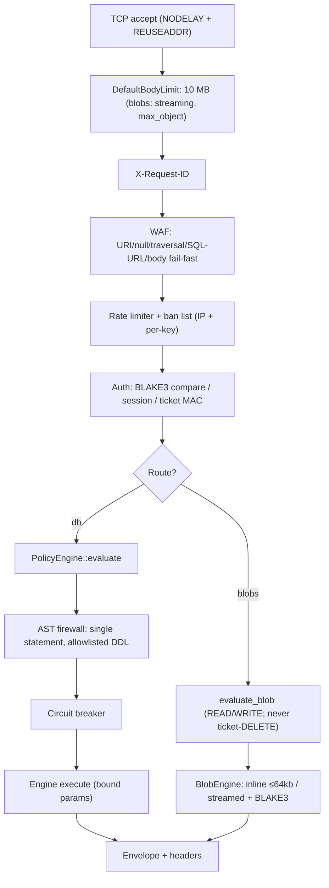
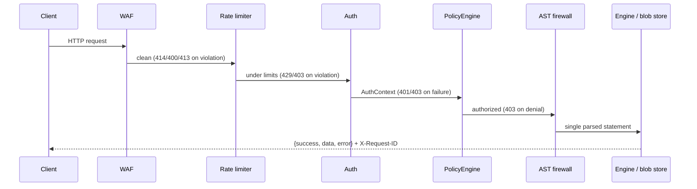
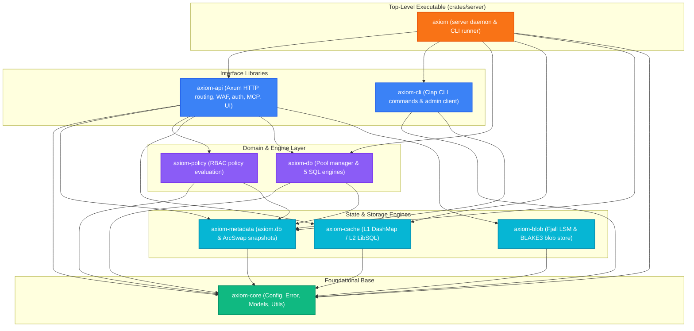

<div align="center">

# Request pipeline architecture

**One picture of every request's lifecycle — then the details, layer by layer.**

</div>

---

## Contents

- [Flowchart](#flowchart)
- [Sequence](#sequence)
- [Security headers](#security-headers-every-response)
- [Crate graph](#crate-dependency-graph)
- [Engine routing / snapshots / cache](#database-engine-routing)

---

## Flowchart



## Sequence



Every inbound HTTP request passes through the following stack. Axum applies middleware in reverse registration order — `waf_middleware` is registered last in `create_app()` and therefore executes first.

```
TCP Accept (socket2 TCP_NODELAY + SO_REUSEADDR)
  │
  ▼
DefaultBodyLimit (10 MB hard cap — kernel-level, before waf_middleware body check)
  │
  ▼
SetRequestIdLayer (X-Request-ID UUID v4 injected)
  │
  ▼
WAF (waf.rs)
  Checks: 2048-char URI, null bytes (case-insensitive, 5× decode), query flood (>50), Content-Length fail-fast (chunked → 10 MB axum cap on non-blob), traversal (`..`), expanded SQL keywords in URL (defense-in-depth)
  │
  ▼
Rate Limiter + Ban List (rate_limit.rs)
  IP resolution: TCP peer → X-Forwarded-For only if peer ∈ trusted_proxies
  Buckets: per-IP (DashMap atomic) + per-key (separate bucket)
  Auto-ban: BanList::ban_ip() after 5 auth failures or penalty_threshold rate violations
  │
  ▼
Auth Middleware (auth.rs)
  Header: X-Axiom-Key, X-Api-Key, Authorization Bearer
  Lookup: ArcSwap<MetadataSnapshot> → zero DB calls
  Verify: BLAKE3(secret) vs stored hash via 32-byte XOR accumulator (constant-time)
  Fallback: config.toml [api_key.*] entries
  Injects: AuthContext extension into request
  │
  ▼
Axum Route Handler
  │
  ├─ SQL Data API (/api/v1/db/*)
  │    1. PolicyEngine::evaluate(auth, database, table, operation)
  │    2. Circuit breaker check (CIRCUIT_FAILURES DashMap per alias)
  │    3. Engine acquire from DatabasePoolManager
  │    4. Mutation heuristic regex (MUTATION_RE)
  │    5. Cache key compute (SHA-256 over alias+sql+params)
  │    6. AST cache lookup → if hit: PolicyEngine::evaluate, skip parse
  │       AST cache miss → sqlparser parse, PolicyEngine::evaluate, cache AST
  │    7. Blacklist check (query_blacklist from db config)
  │    8. Result cache lookup (DashMap) — AFTER RBAC
  │    9. DB engine execute (parameterized positional bindings, JSONB & dollar quotes preserved)
  │    10. Circuit breaker reset on success / increment on failure
  │    11. Result cache store (with differentiated negative_cache_ttl for empty results)
  │
  ├─ Blob Storage API (/api/v1/blobs/*)
   │    1. Auth validation (X-Axiom-Key, session Bearer, or `?ticket_sig=&ticket_exp=` BLAKE3 MAC)
   │    2. PolicyEngine::evaluate_blob(auth, namespace, key, operation) — READ/WRITE only for tickets; DELETE never ticket-scoped
  │    3. Key sanitization (path traversal & prefix recursion prevention)
  │    4. BlobEngine operations:
  │       - Inline payloads (<= 64KB) read/write directly to LSM index (Fjall)
  │       - External payloads stream to disk with BLAKE3 checksum verification
  │       - Multipart uploads assembled and sealed on completion
  │       - HTTP Range requests (206 Partial Content) & CAS (If-Match)
  │
  └─ Response
       JSON envelope or binary stream + security headers
```

---

## Security headers (every response)

Applied via `SetResponseHeaderLayer` (overriding or if-not-present):

| Header | Value |
|--------|-------|
| `X-Request-ID` | UUID v4, unique per request |
| `X-Content-Type-Options` | `nosniff` |
| `X-Frame-Options` | `DENY` |
| `Strict-Transport-Security` | `max-age=63072000; includeSubDomains; preload` (effective only over HTTPS) |
| `Content-Security-Policy` | `default-src 'none'; frame-ancestors 'none';` (if-not-present — Web UI handler overrides) |
| `Referrer-Policy` | `no-referrer` |
| `Permissions-Policy` | `camera=(), microphone=(), geolocation=()` |

---

## Crate Dependency Graph

Axiom is architected as a clean, strictly layered Directed Acyclic Graph (DAG) across 9 Cargo workspace crates. Foundational crates never depend on higher-level layers, preventing circular dependencies and ensuring fast parallel compilation.



### Layered Hierarchy & Responsibilities

```
Layer 4: Server Executable (crates/server)
  └── axiom (main entrypoint — initializes Tokio runtime, socket tuning, launches server/CLI)
        └── Links: axiom-api, axiom-cli, axiom-db, axiom-cache, axiom-metadata, axiom-core

Layer 3: Interface Libraries
  ├── axiom-api (crates/api) — Axum routing, middleware pipeline (WAF, rate-limiting, auth), MCP, UI
  │     └── Depends on: axiom-core, axiom-metadata, axiom-policy, axiom-cache, axiom-db, axiom-blob
  └── axiom-cli (crates/cli) — CLI commands, argument parsing, Admin HTTP client
        └── Depends on: axiom-core, axiom-metadata

Layer 2: Domain & Access Engines
  ├── axiom-policy (crates/policy) — RBAC policy evaluation for SQL tables & Blob namespaces
  │     └── Depends on: axiom-core, axiom-metadata
  └── axiom-db (crates/db) — Connection pooling & SQL engine implementations (PG, MySQL, MSSQL, LibSQL, ClickHouse)
        └── Depends on: axiom-core, axiom-metadata

Layer 1: State & Storage Engines
  ├── axiom-metadata (crates/metadata) — SQLite/libsql metadata store, ArcSwap snapshot publisher, audit log
  │     └── Depends on: axiom-core
  ├── axiom-cache (crates/cache) — Unified L1 DashMap LRU + L2 SQLite persistent cache
  │     └── Depends on: axiom-core
  └── axiom-blob (crates/blob) — Embedded Fjall LSM index, chunked uploads, BLAKE3 content-addressed storage
        └── Depends on: axiom-core

Layer 0: Foundational Base
  └── axiom-core (crates/core) — Core models (QueryResult, ColumnInfo), ConfigManager, AxiomError, utils
        └── Zero internal workspace dependencies (leaf crate)
```

No circular dependencies exist. Domain engines (`axiom-db`, `axiom-blob`, `axiom-cache`) do not depend on interface layers (`axiom-api`, `axiom-cli`), and `axiom-core` remains completely decoupled from external storage drivers.

---

## Database Engine Routing

URL prefix → engine selection in `DatabasePoolManager::get_engine`:

| URL Prefix | Engine | Driver |
|-----------|--------|--------|
| `postgres://`, `postgresql://` | `PostgresDatabaseEngine` | sqlx |
| `mysql://`, `mariadb://` | `MysqlDatabaseEngine` | sqlx |
| `mssql://`, `sqlserver://` | `MssqlDatabaseEngine` | tiberius (URL translated to `jdbc:sqlserver://` internally) |
| `sqlite://`, `libsql://` | `LibsqlDatabaseEngine` | libsql |
| `clickhouse://`, `clickhouse+https://` | `ClickHouseDatabaseEngine` | reqwest HTTP |

All engines implement the `DatabaseEngine` trait: `connect`, `disconnect`, `health_check`, `list_tables`, `count_tables`, `describe_table`, `get_foreign_keys`, `execute`, `dialect`.

---

## Metadata Snapshot Refresh

```
Background daemon (lifespan.rs)
  Every reload_interval seconds:
    MetadataStore::load_snapshot() → reads axiom.db
    ArcSwap::store(Arc::new(snapshot))

Hot path (auth.rs, rate_limit.rs, router.rs):
  ArcSwap::load() → Arc clone (no locks, no DB calls)
```

Force refresh: `POST /admin/v1/reload` or `axiom reload` CLI.

---

## Cache Architecture

Three use-cases share a single `CacheEngine`:

| Use-case | Key prefix | TTL source |
|----------|-----------|------------|
| SQL result cache | `q:` | `cache.query_results_ttl` |
| Negative caching (empty SQL results) | `q:` | `cache.negative_cache_ttl` |
| Idempotency responses | `idemp:` | `cache.idempotency_ttl` |
| Rate limit counters | `rl:ip:`, `rl:key:` | `rate_limit.window` |

L1: `DashMap<String, (Bytes, Instant)>` with background TTL sweep using a `BinaryHeap`.
L2: Optional SQLite AOF via libsql (when `cache.backend = "hybrid"` or `"turso"`).

AST cache is separate: `once_cell::Lazy<DashMap<String, CachedAstInfo>>` bounded at `performance.query_cache_size` entries with arbitrary eviction on overflow.
