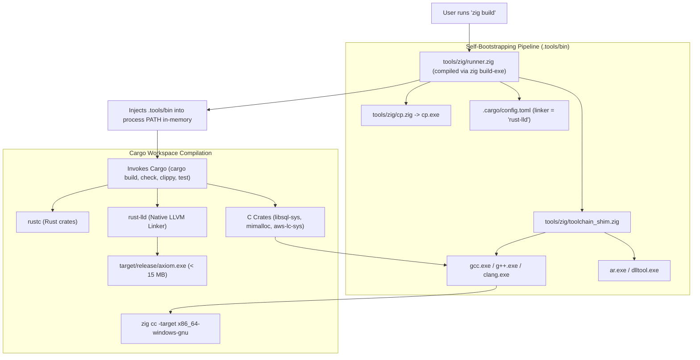

<div align="center">

# Axiom Build & Toolchain Guide

### Zero-Bloat, Self-Bootstrapping C/C++ and Rust Toolchain with Zig
**No MSYS64 · No MinGW · No Visual Studio Build Tools · Sub-15MB Binary**

[](https://github.com/toxichome-whoami/axiom/releases)
[](https://www.rust-lang.org)
[](https://ziglang.org)
[](../LICENSE)
[](https://github.com/toxichome-whoami/axiom/releases)

</div>

---

## Contents

1. [Overview](#1-overview)
2. [Quick Start](#2-quick-start)
3. [Toolchain Architecture](#3-toolchain-architecture)
4. [Development & Build Commands](#4-development--build-commands)
5. [Direct Cargo Usage](#5-direct-cargo-usage)
6. [Release Optimization & Binary Footprint](#6-release-optimization--binary-footprint)
7. [Directory Lifecycle & Clean-Up](#7-directory-lifecycle--clean-up)
8. [Troubleshooting & FAQ](#8-troubleshooting--faq)

---

## 1. Overview

Axiom integrates several high-performance Rust crates that compile embedded C/C++ dependencies:
* `libsql-sys` (embedded SQLite / Turso storage engine)
* `mimalloc-sys` (hardened, high-concurrency memory allocator)
* `aws-lc-sys` / `ring` (FIPS-capable cryptographic primitives)

Traditionally on Windows, compiling Rust crates containing native C/C++ code requires either:
* **Visual Studio Build Tools**: 5–10 GB download, registry changes, background telemetry services.
* **MSYS64 / MinGW-w64**: 1–2 GB environment, slow POSIX fork emulation, frequent PATH conflicts.

Axiom replaces both with a **native, self-bootstrapping build pipeline powered by [Zig](https://ziglang.org)**. Zig provides a portable Clang/LLVM C/C++ compiler and assembler in a single portable ~40 MB archive with zero runtime dependencies.

| Property | Traditional Windows (MSVC / MSYS64) | Axiom Zig Toolchain |
|---|---|---|
| **Download size** | 5–10 GB (MSVC) or ~1.5 GB (MSYS64) | **~40 MB** (portable Zig archive) |
| **Setup time** | 20–45 minutes with system reboot | **< 5 seconds** (unzip and add to PATH) |
| **System pollution** | Visual Studio installers, system PATH bloat | **Zero** (in-memory PATH injection, local shims) |
| **Cross-compilation** | Requires separate target SDKs | **Built-in** (`zig cc -target ...`) |
| **Resulting binary** | Often statically links heavy runtime DLLs | **Sub-15 MB standalone binary** |

---

## 2. Quick Start

### Prerequisites

| Tool | Minimum | Recommended | Purpose |
|---|---|---|---|
| **Rust** | `1.88+` | `stable-x86_64-pc-windows-gnu` or `stable-x86_64-unknown-linux-gnu` | Rust workspace compiler and `cargo` |
| **Zig** | `0.13+` | `0.13.0` or `0.14+` | Portable C/C++ compiler and toolchain shims |
| **Node.js** | `18+` | `20 LTS` | Admin Web UI compilation (`ui/`) |

### 3-Step Build

```bash
# 1. Clone repository
git clone https://github.com/toxichome-whoami/axiom.git
cd axiom

# 2. Build the embedded Admin Web UI bundle
npm --prefix ui run build

# 3. Compile release binary via Zig self-bootstrapping runner
zig build
```

The compiled binary will be placed at:
* **Windows**: `target/release/axiom.exe`
* **Linux / macOS**: `target/release/axiom`

Verify the output:

```bash
./target/release/axiom --version
```

> [!NOTE]
> If you are not modifying the Admin Web UI, step 2 can be skipped after the initial build, as assets in `ui/dist/` are embedded directly into the Rust binary via `rust-embed`.

---

## 3. Toolchain Architecture



### Components

1. **Native Runner (`tools/zig/runner.zig`)**:
   A shell-independent native runner compiled via `zig build-exe`. It manages `.tools/bin/`, compiles toolchain shims, dynamically prepends `.tools/bin` to the child process `PATH`, and dispatches commands directly to `cargo`.
2. **Toolchain Shims (`tools/zig/toolchain_shim.zig`)**:
   Lightweight shims that intercept calls from Rust build scripts (`build.rs`) to `gcc`, `g++`, `ar`, and `dlltool`:
   * **Target Normalization**: Automatically converts GNU target triples (`--target=x86_64-pc-windows-gnu`) to Zig format (`-target x86_64-windows-gnu`).
   * **Warning Hygiene**: Injects `-Wno-date-time` to prevent warnings-as-errors failures in `mimalloc`'s build macros.
   * **UBSan De-instrumentation**: Injects `-fno-sanitize=all` to prevent Clang from inserting unneeded debug sanitizer symbols (`__ubsan_handle_*`) into C objects linked by `rust-lld`.
   * **DLLTool Architecture**: Injects `-m i386:x86-64` into `dlltool` to guarantee correct 64-bit Windows import libraries.
3. **Windows `cp` Utility (`tools/zig/cp.zig`)**:
   A native Zig file-copy utility that replaces MSYS64 Unix coreutils during `libsql-ffi` amalgamation builds.

---

## 4. Development & Build Commands

For day-to-day development, use `zig build` or the compiled `tools/zig/runner` binary:

| Command | Action Executed | Purpose |
|---|---|---|
| **`zig build`** | `cargo build --release` | Compiles runner, bootstraps shims, and builds optimized release binary |
| **`zig build version`** | `tools/zig/version.zig` | Inspect current workspace version across all crates and docs |
| **`zig build version -Dto=patch`** | `tools/zig/version.zig` | Atomically bump patch version across workspace |
| **`zig build test-e2e`** | `tools/zig/simulate_e2e.zig` | Run comprehensive end-to-end simulation in Zig |
| **`tools/zig/runner`** | `cargo build --release` | Fast release build using existing runner binary |
| **`tools/zig/runner dev`** | `cargo build` | Fast unoptimized debug build in `target/debug/` |
| **`tools/zig/runner check`** | `cargo check` | Sub-second workspace type check and syntax verification |
| **`tools/zig/runner clippy`** | `cargo clippy` | Workspace-wide linting and safety checks |
| **`tools/zig/runner test`** | `cargo test` | Run the full workspace unit and integration test suite |
| **`tools/zig/runner test <filter>`** | `cargo test <filter>` | Run only tests matching a name filter |
| **`tools/zig/runner run`** | `cargo run` | Compile and launch the server daemon |
| **`tools/zig/runner setup`** | `ensure_setup()` | Force re-compilation of shims in `.tools/bin` |
| **`tools/zig/runner cargo <...>`** | `cargo <...>` | Forward any arbitrary flags directly to Cargo |

> [!TIP]
> On Windows, invoke `tools\zig\runner.exe <cmd>`. On Linux and macOS, use `./tools/zig/runner <cmd>`. Both behave identically.

---

## 5. Direct Cargo Usage

If you prefer invoking `cargo` directly in your terminal without the `runner` prefix, export `.tools/bin` into your current shell session:

### PowerShell (Windows)

```powershell
# 1. Ensure toolchain shims are generated
.\tools\zig\runner.exe setup

# 2. Prepend .tools/bin to current session PATH
$env:PATH = (Resolve-Path .tools/bin).Path + ';' + $env:PATH

# 3. Run standard Cargo commands directly
cargo check --workspace
cargo test --workspace
cargo build --release
```

### Bash / Zsh (Linux & macOS)

```bash
# 1. Ensure toolchain shims are generated
./tools/zig/runner setup

# 2. Prepend .tools/bin to current session PATH
export PATH="$(pwd)/.tools/bin:$PATH"

# 3. Run standard Cargo commands directly
cargo check --workspace
cargo test --workspace
cargo build --release
```

---

## 6. Release Optimization & Binary Footprint

Axiom enforces aggressive release profile settings in the root `Cargo.toml` to produce a minimal, self-contained single binary:

```toml
[profile.release]
opt-level = 3          # Maximum compiler optimizations
lto = "thin"           # Cross-crate Thin Link-Time Optimization
codegen-units = 1      # Single unit maximizes inlining opportunities
panic = "abort"        # Drops unwinding tables and landing pads
strip = true           # Strips symbols, debug info, and symbol tables
```

### Binary Metrics

| Component | Unstripped Size | Stripped Release (`zig build`) | Idle RAM Footprint |
|---|---|---|---|
| **`axiom.exe` / `axiom`** | ~45 MB | **< 15 MB** | **~18 MB RSS** |

The resulting executable includes:
* Embedded REST and Admin APIs
* Embedded Web UI dashboard (Vite single-page app)
* Content-addressed BLAKE3 blob engine (Fjall LSM)
* High-concurrency SQL query engine and AST transpiler
* In-memory / hybrid query and response caches

---

## 7. Directory Lifecycle & Clean-Up

Axiom keeps generated toolchain artifacts cleanly partitioned:

| Directory | Generated by | Tracked in Git? | Safe to delete? |
|---|---|---|---|
| `.tools/` | `tools/zig/runner.zig` | No (`.gitignore`) | **Yes** — auto-recreated on next run |
| `.cargo/config.toml` | `tools/zig/runner.zig` | No (`.gitignore`) | **Yes** — auto-recreated on next run |
| `target/` | Cargo compiler | No (`.gitignore`) | **Yes** — run `cargo clean` |
| `ui/dist/` | `npm run build` | No (`.gitignore`) | **Yes** — re-built via `npm --prefix ui run build` |

> [!NOTE]
> If `.tools/` is ever deleted, running any `zig build` or `tools/zig/runner` command automatically detects its absence and regenerates all shims on-the-fly.

---

## 8. Troubleshooting & FAQ

| Problem | Cause | Solution |
|---|---|---|
| **`'zig' is not recognized`** | Zig binary is not in your system `PATH` | Download Zig from [ziglang.org](https://ziglang.org/download/), extract it, and add the directory to your `PATH`. |
| **`C compiler not found` during build** | Cargo was invoked directly without `.tools/bin` in `PATH` | Run through `tools/zig/runner`, or run `tools/zig/runner setup` and add `.tools/bin` to `PATH`. |
| **Web UI returns 404 or blank page** | Admin Web UI assets were not compiled before packaging | Run `npm --prefix ui run build` and re-compile the binary. |
| **Antivirus alert on `.tools/bin/gcc.exe`** | Heuristic scanner flags freshly compiled local shim executable | The file is a clean 50-line shim compiled from `tools/zig/toolchain_shim.zig`. Add `.tools/` to your antivirus exclusion list. |
| **Rust linker error (`rust-lld`)** | Toolchain target mismatch on Windows | Ensure you are using the GNU toolchain: `rustup default stable-x86_64-pc-windows-gnu`. |
