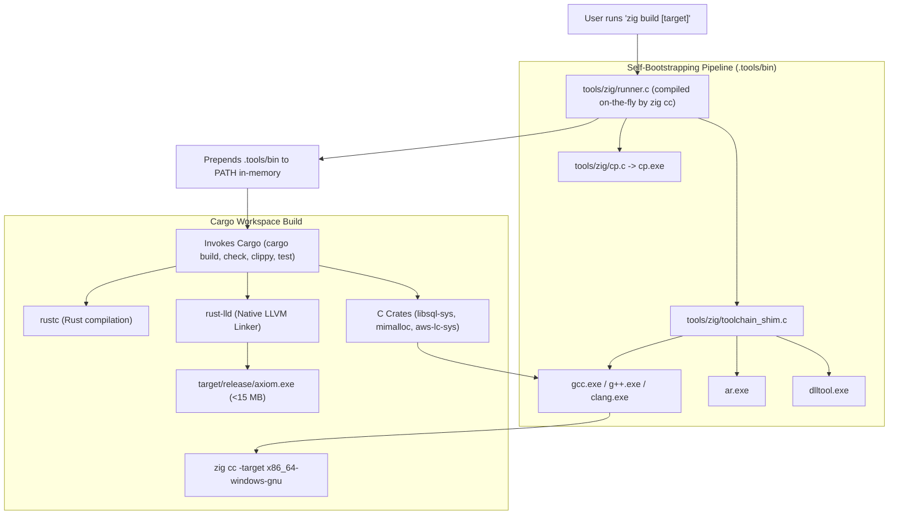

<div align="center">

# Axiom Build & Toolchain Guide

### Zero-Bloat, Self-Bootstrapping C/C++ and Rust Toolchain with Zig
**No MSYS64 · No MinGW · No Visual Studio Build Tools · Sub-15MB Binary**

[](https://github.com/toxichome/axiom/releases)
[](https://www.rust-lang.org)
[](https://ziglang.org)
[](../LICENSE)
[](https://github.com/toxichome/axiom/releases)

</div>

---

## Overview

Axiom integrates several high-performance Rust crates that compile embedded C/C++ dependencies (`libsql-sys`, `mimalloc-sys`, `aws-lc-sys`, and `ring`). Traditionally on Windows, building crates with C code requires either:
* **Visual Studio C++ Build Tools** (5–10 GB download, complex installer)
* **MSYS64 / MinGW-w64** (1–2 GB environment, slow shell bridges, frequent path collisions)

To keep Axiom true to its design philosophy (**small, lightweight, and zero-bloat**), Axiom provides a **native, self-bootstrapping build pipeline powered by [Zig](https://ziglang.org)**. Zig provides a drop-in, cross-platform Clang/LLVM C/C++ compiler and assembler in a single portable zip (~40 MB) with zero runtime dependencies.

---

## Toolchain Architecture



### Components

1. **Native Runner (`tools/zig/runner.c`)**:
   A shell-independent C99 runner compiled automatically by `zig cc`. It configures directory structures, compiles toolchain shims, dynamically prepends `.tools/bin` to the process `PATH`, and dispatches commands to `cargo` or `npm`.
2. **Toolchain Shims (`tools/zig/toolchain_shim.c`)**:
   Lightweight shims that intercept calls from Rust build scripts (`build.rs`) to `gcc`, `g++`, `ar`, and `dlltool`:
   * **Target Normalization**: Automatically converts GNU target triples (`--target=x86_64-pc-windows-gnu`) to Zig-compatible format (`-target x86_64-windows-gnu`).
   * **Warning Management**: Injects `-Wno-date-time` to prevent warnings-as-errors failures in `mimalloc`'s date/time macros.
   * **UBSan De-instrumentation**: Injects `-fno-sanitize=all` to prevent Clang from inserting unneeded debug sanitizer runtime symbols (`__ubsan_handle_*`) into C objects linked by `rust-lld`.
   * **DLLTool Architecture**: Injects `-m i386:x86-64` into `dlltool` to guarantee correct 64-bit Windows import libraries.
3. **Windows `cp` Utility (`tools/zig/cp.c`)**:
   A 25-line native C file copier supporting recursive copying (`-R`), eliminating the need for MSYS64 Unix coreutils during `libsql-ffi` amalgamation builds.

---

## Build Targets Reference

Axiom's `build.zig` provides standard commands for every stage of development:

| Command | Underlying Action | Target Profile | Purpose |
|---|---|---|---|
| **`zig build`** | `cargo build --release` | `release` | Optimized production binary placed in `target/release/axiom` (<15 MB) |
| **`zig build dev`** | `cargo build` | `dev` | Fast unoptimized debug build in `target/debug/axiom` for local testing |
| **`zig build check`** | `cargo check --workspace` | `dev` | Sub-second workspace type check and AST syntax verification |
| **`zig build clippy`** | `cargo clippy --workspace --all-targets` | `dev` | Strict workspace-wide linting with all warnings addressed |
| **`zig build test`** | `cargo test --workspace -- --test-threads=1` | `test` | Executes the complete 255-test unit & integration test suite |
| **`zig build fmt`** | `cargo fmt --check` | N/A | Verifies Rust code style compliance across all crates |
| **`zig build run`** | `cargo run --bin axiom -- server run` | `dev` | Builds and immediately launches the Axiom server daemon |
| **`zig build ui`** | `npm --prefix ui run build` | `production` | Typechecks and bundles the Administrative Web UI (`ui/dist/`) |
| **`zig build setup`** | `runner setup` | N/A | Explicitly re-generates all shims in `.tools/bin` |

---

## Quickstart Walkthrough

### 1. Prerequisites
* **Rust**: `1.88+` (recommended: `stable-x86_64-pc-windows-gnu` for zero MSVC bloat, or standard host toolchain)
* **Zig**: `0.13+` or `0.14+` / `0.17+` (accessible on `PATH`)
* **Node.js**: `18+` (only needed if building or modifying the Web UI frontend)

### 2. Clone and Build
```bash
git clone https://github.com/toxichome/axiom.git
cd axiom

# Build the release binary in one command:
zig build
```

The resulting executable will be located at:
* **Windows**: `target/release/axiom.exe`
* **Linux / macOS**: `target/release/axiom`

### 3. Verify Build
```bash
./target/release/axiom --version
```

---

## Arbitrary Cargo Passthrough

If you want to run arbitrary `cargo` commands while ensuring the Zig C compiler and `ar` shims are available on `PATH`, invoke the runner directly:

**Windows:**
```cmd
tools\zig\runner.exe cargo <any-cargo-command>
```

**Linux / macOS:**
```bash
./tools/zig/runner cargo <any-cargo-command>
```

Examples:
```bash
# Update dependencies:
./tools/zig/runner cargo update

# Inspect dependency tree:
./tools/zig/runner cargo tree -p axiom-api

# Run benchmarks:
./tools/zig/runner cargo bench -p axiom-benches
```

---

## Direct Cargo Usage (Without Zig Runner)

If you prefer using standard `cargo` commands directly in your terminal, add the generated `.tools/bin` folder to your current session's `PATH`:

#### PowerShell (Windows):
```powershell
zig build setup
$env:PATH = (Resolve-Path .tools/bin).Path + ';' + $env:PATH
cargo check --workspace
cargo test --workspace
```

#### Bash / Zsh (Linux & macOS):
```bash
zig build setup
export PATH="$(pwd)/.tools/bin:$PATH"
cargo check --workspace
cargo test --workspace
```

---

## Ephemeral Directory Lifecycle

* **`.tools/`**: Contains the compiled shims (`gcc.exe`, `ar.exe`, `cp.exe`, etc.). This directory is strictly local and ignored by Git ([.gitignore](../.gitignore)).
* **Auto-Recovery**: If `.tools/` is ever deleted or cleaned, running any `zig build` command will **automatically detect its absence and recreate it on-the-fly** without manual intervention.
* **`.cargo/`**: Local configuration created by the setup runner mapping `linker = "rust-lld"` and `CC = "gcc.exe"`. Ignored by Git to preserve user environment isolation.
