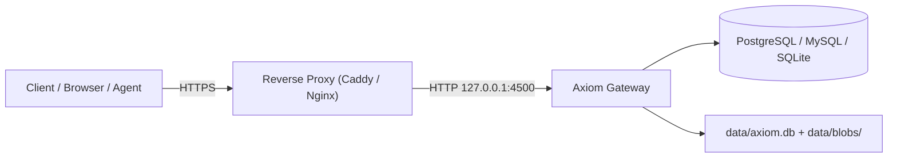

<div align="center">

# Axiom Configuration & Deployment Guide

**Configuration reference, security architecture, and production deployment.**

</div>

---

## Configuration (`config.toml`)

Axiom loads configuration once at startup from `config.toml` located in the current working directory.

Dynamic metadata (API keys, roles, database aliases, and active sessions) is stored in `data/axiom.db` and refreshed automatically without server restarts.

### Configuration Precedence

1. Compiled system defaults
2. `config.toml` file
3. Environment variables (using double-underscore delimiter, e.g. `SERVER__PORT=4500`)
4. `.env` file (loaded on startup if present)

---

## Complete `config.toml` Reference

```toml
[server]
host = "127.0.0.1"
port = 4500
workers = 4                        # Thread count (0 = auto-detect CPU cores)
max_connections = 10000
request_timeout = 30               # Global request timeout in seconds
body_limit = "10mb"                # Maximum request body size
cors_origins = ["*"]
trusted_proxies = ["127.0.0.1"]    # IPs trusted for X-Forwarded-For
allowed_ips = ["127.0.0.1"]        # Exact IPs exempt from rate limiting
shutdown_timeout = 30              # Seconds to drain in-flight requests

[logging]
enabled = true
level = "INFO"                     # TRACE | DEBUG | INFO | WARN | ERROR
format = "json"                    # "json" (production) or "pretty" (development)
directory = "./logs"
file_prefix = "axiom"
max_file_size = "50mb"             # Max log size before rotation
max_files = 5                      # Number of rotated segments to retain
stdout = true

[metadata]
url = "file:data/axiom.db"         # Local SQLite file or remote Turso libsql URL
token = ""                         # Auth token for remote Turso (empty for local)
reload_interval = 30               # Seconds between automatic cache snapshot refreshes

[rate_limit]
enabled = true
backend = "memory"                 # "memory" or "turso"
turso_url = "file:data/cache.db"
turso_token = ""
window = 60                        # Time window in seconds
max_requests = 100                 # Max requests per window
burst = 20                         # Allowed burst over max
penalty_threshold = 10             # Limit violations before IP ban
penalty_cooldown = 300             # Ban duration in seconds

[cache]
enabled = true
backend = "memory"                 # "memory" or "hybrid"
turso_url = "file:data/cache.db"
turso_token = ""
max_memory = "100mb"
default_ttl = 60
query_cache = true
idempotency_ttl = 86400            # Cache TTL for Idempotency-Key responses (24 hours)
response_cache_ttl = 30
query_results_ttl = 5              # Cache TTL in seconds for repeated SELECT queries
negative_cache_ttl = 5

[circuit_breaker]
enabled = true
failure_threshold = 5              # Consecutive failures before opening circuit
success_threshold = 3              # Successes required in half-open to recover
timeout = 30                       # Seconds to wait before testing recovery

[blob]
enabled = true                     # Enable embedded blob storage engine
path = "data/blobs"                # Base directory for LSM index and blob files
inline_max = "64kb"                # Payloads <= this threshold stored inline
max_object = "5gb"                 # Hard ceiling on single blob upload size
verify_reads = false               # Re-verify BLAKE3 checksums on reads
```

> **Dynamic State Management:**
> Database connections, API keys, and access roles are stored in `data/axiom.db` (or remote Turso) and cannot be defined in `config.toml`. Manage them via the Web Console (`http://localhost:4500/system`) or the Axiom CLI (`axiom db add`, `axiom key create`).

---

## Security Model

Every request to Axiom runs through an ordered, deterministic protection pipeline before reaching database drivers or storage shards.

### 1. Web Application Firewall (WAF)
- Restricts request URI length to 2048 bytes
- Rejects null bytes (`%00`)
- Performs 3-pass URL decoding to block nested path traversal sequences (`%252e%252e`)
- Enforces strict payload limits (`body_limit`)

### 2. Dual Rate Limiting
- Tracks request rates across two parallel buckets: `rl:ip:{ip}` and `rl:key:{key_name}`
- Attackers rotating source IP addresses cannot bypass rate limits on a compromised key
- Automatic IP bans trigger after 5 consecutive authorization failures

### 3. Authentication & Key Hashing
- API keys are looked up against an in-memory `ArcSwap<Metadata>` snapshot (zero database locks on the hot path)
- Secret validation executes via constant-time XOR comparison to prevent timing side-channels
- Secrets are stored as BLAKE3 cryptographic hashes, never in plaintext

### 4. RBAC Authorization
- API keys are associated with custom operator-defined roles
- Every operation is validated by the `PolicyEngine` against `(database, table, operation)` tuples
- Supported operations: `SELECT`, `INSERT`, `UPDATE`, `DELETE`, `READ`, `WRITE`

### 5. Security Headers
Every response emitted by Axiom includes defensive headers:
- `X-Content-Type-Options: nosniff`
- `X-Frame-Options: DENY`
- `Strict-Transport-Security: max-age=63072000; includeSubDomains; preload`
- `Content-Security-Policy: default-src 'none'; frame-ancestors 'none';`

---

## Production Deployment

### Recommended Topology

Axiom serves plain HTTP on `127.0.0.1:4500` by default. Run Axiom behind a reverse proxy (Caddy, Nginx, or Apache) that terminates TLS and proxies traffic locally.



### Reverse Proxy Configuration

#### Caddy (Automatic HTTPS)

```caddyfile
api.example.com {
    reverse_proxy 127.0.0.1:4500
}
```

#### Nginx

```nginx
server {
    listen 443 ssl http2;
    server_name api.example.com;

    ssl_certificate /etc/letsencrypt/live/api.example.com/fullchain.pem;
    ssl_certificate_key /etc/letsencrypt/live/api.example.com/privkey.pem;

    client_max_body_size 50M;

    location / {
        proxy_pass http://127.0.0.1:4500;
        proxy_set_header Host $host;
        proxy_set_header X-Real-IP $remote_addr;
        proxy_set_header X-Forwarded-For $proxy_add_x_forwarded_for;
        proxy_set_header X-Forwarded-Proto https;
    }
}
```

### Systemd Service

Create `/etc/systemd/system/axiom.service`:

```ini
[Unit]
Description=Axiom Database Gateway
After=network.target

[Service]
Type=simple
User=axiom
Group=axiom
WorkingDirectory=/opt/axiom
ExecStart=/opt/axiom/axiom server run
Restart=always
RestartSec=5
LimitNOFILE=65536

[Install]
WantedBy=multi-user.target
```

```bash
sudo systemctl daemon-reload
sudo systemctl enable --now axiom
```

### File System Permissions & Backups

- Protect configuration and metadata database:
  ```bash
  chmod 600 config.toml
  chmod 600 data/axiom.db
  ```
- Back up `data/axiom.db` and `data/blobs/` concurrently to preserve metadata and file storage integrity.
