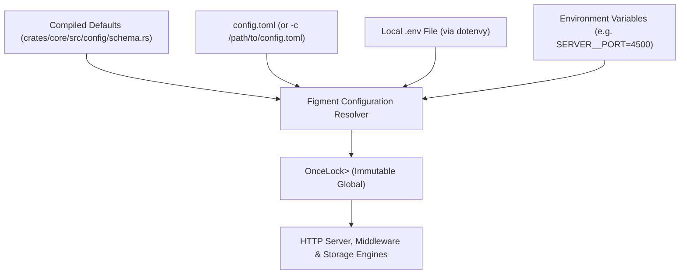

<div align="center">

# Axiom Configuration Reference (`config.toml`)

### Complete Reference for Startup Settings, Modules, Defaults, and Environment Overrides
**Single Binary Gateway · Immutable Startup Configuration · Lock-Free Arc Access**

[](https://github.com/toxichome-whoami/axiom/releases)
[](https://www.rust-lang.org)
[](../LICENSE)
[](https://github.com/toxichome-whoami/axiom/releases)

</div>

---

## Configuration Model & Lifecycle

Axiom uses `config.toml` strictly for **process-level startup configuration**: network interfaces, thread workers, logging, memory caps, circuit breakers, and storage roots.



### Key Invariants
- **Immutable at Runtime**: `config.toml` is read once during process startup and frozen in an immutable `OnceLock<Arc<AxiomConfig>>`. Modifying `config.toml` requires a process restart.
- **Zero-Lock Hot Path**: Request handlers and middleware read configuration via lock-free `Arc` clones, incurring zero mutex or lock contention.
- **Precedence Hierarchy** (highest to lowest priority):
  1. **CLI Flags** (e.g., `axiom server run -c /etc/axiom.toml --port 4500`)
  2. **Environment Variables** (e.g., `SERVER__PORT=4500`)
  3. **Local `.env` File** (automatically loaded from current working directory via `dotenvy`)
  4. **`config.toml` File** (loaded from current directory or `-c/--config` path)
  5. **Compiled Defaults** (hardcoded in `crates/core/src/config/schema.rs`)

> [!IMPORTANT]
> **What is NOT in `config.toml`**:
> Database connection strings, API keys, RBAC roles, and cluster mesh peers are dynamic metadata stored in the embedded LibSQL database (`data/axiom.db`). They are managed exclusively through the Admin Web UI (`/system`), CLI (`axiom db`, `axiom key`, `axiom role`, `axiom cluster`), or the Admin REST API. They cannot be defined in `config.toml`.

---

## Loading & File Discovery

### Default Path
By default, `axiom server run` looks for `config.toml` in the current working directory. If `config.toml` is not present, Axiom boots immediately using compiled defaults and binds to `127.0.0.1:4500`.

### Custom Configuration Path
Pass the `-c` or `--config` flag to load configuration from an arbitrary path:

```bash
axiom server run -c /etc/axiom/production.toml
```

### Generating Configuration via CLI
The `axiom config` subcommand provides tools to initialize and inspect configuration:

```bash
# Initialize a new config.toml with standard defaults in the current directory
axiom config init

# Output configuration as an environment variable .env template
axiom config to-env

# Validate and inspect resolved configuration values
axiom config show
```

---

## Complete `config.toml` Blueprint

Below is the complete reference `config.toml` representing all available modules, keys, and production defaults:

```toml
# ==============================================================================
# Axiom Master Configuration (config.toml)
# All changes require a server restart to take effect.
# ==============================================================================

# --- Server & Network Settings ---
[server]
host = "127.0.0.1"                 # TCP network interface to bind
port = 4500                        # TCP port for incoming HTTP traffic
workers = 0                        # Tokio worker threads (0 = auto-detect CPU cores)
max_connections = 10000            # Concurrency ceiling for simultaneous TCP sockets
request_timeout = 30               # Global request execution timeout in seconds
body_limit = "10mb"                # Hard ceiling on single HTTP request payloads
tls_cert = ""                      # Path to TLS certificate PEM (empty for plain HTTP)
tls_key = ""                       # Path to TLS private key PEM
allowed_ips = ["127.0.0.1"]        # Client IPs completely exempt from rate limits
trusted_proxies = ["127.0.0.1"]    # Upstream proxy IPs trusted for X-Forwarded-For
cors_origins = ["*"]               # Allowed CORS origins (e.g. ["https://app.example.com"])
shutdown_timeout = 30              # Grace period in seconds to drain in-flight requests

# --- Structured Logging ---
[logging]
enabled = true                     # Master toggle for file and terminal log emission
level = "INFO"                     # Log severity: "TRACE" | "DEBUG" | "INFO" | "WARN" | "ERROR"
format = "json"                    # Serialization format: "json" (production) or "pretty" (dev)
directory = "./logs"               # Output directory for rotating log files
file_prefix = "axiom"              # Prefix for log files (<prefix>.<timestamp>.log)
max_file_size = "50mb"             # Maximum uncompressed log segment size before rotation
max_files = 5                      # Number of historical rotated log files to retain
stdout = true                      # Mirror structured log records directly to stdout

# --- Rate Limiting & Abuse Defense ---
[rate_limit]
enabled = true                     # Master toggle for dual rate limiting middleware
backend = "memory"                 # Storage backend: "memory" (L1 RAM) or "turso"
turso_url = "file:data/cache.db"   # Persistent storage file if backend = "turso"
turso_token = ""                   # Remote Turso authentication token (if applicable)
window = 60                        # Sliding rate window in seconds
max_requests = 100                 # Maximum allowed requests per window
burst = 20                         # Permitted short-term request burst above max_requests
penalty_threshold = 10             # Limit violations before source IP or key is banned
penalty_cooldown = 300             # Ban duration in seconds

# --- Response & Query Caching ---
[cache]
enabled = true                     # Master toggle for internal response and query caching
backend = "memory"                 # Storage layer: "memory" (L1 RAM) or "hybrid" (L1 + L2 disk)
turso_url = "file:data/cache.db"   # Persistent storage file if backend = "hybrid"
turso_token = ""                   # Remote Turso authentication token (if applicable)
max_memory = "100mb"               # Memory ceiling for L1 DashMap cache
default_ttl = 60                   # Default cache lifetime in seconds
query_cache = true                 # Enable SELECT query result and AST caching
idempotency_ttl = 86400            # Cache retention for Idempotency-Key responses (24 hours)
response_cache_ttl = 30            # Global HTTP response cache TTL in seconds
query_results_ttl = 5              # Cache TTL in seconds for repeated SELECT statements
negative_cache_ttl = 5             # Cache TTL in seconds for 404 / empty lookups

# --- Low-Level Performance Knobs ---
[performance]
query_cache_size = 2048            # Maximum slots for parsed SQL query ASTs
transpiler_cache_size = 4096       # Maximum slots for SQL dialect transpilation results
rate_limit_cache_size = 256        # Maximum slots for rate-limit metadata lookups

# --- Database Circuit Breaker ---
[circuit_breaker]
enabled = true                     # Upstream database fault isolation toggle
failure_threshold = 5              # Consecutive upstream errors before tripping circuit OPEN
success_threshold = 3              # Successful probes in HALF-OPEN required to close circuit
timeout = 30                       # Cooldown seconds to wait before probing broken upstream

# --- Metadata Store (LibSQL / SQLite) ---
[metadata]
url = "file:data/axiom.db"         # Local SQLite file or remote Turso libsql URL
token = ""                         # Bearer authentication token for remote Turso connection
reload_interval = 30               # Seconds between automatic in-memory snapshot updates

# --- Content-Addressed Blob Storage ---
[blob]
path = "data/blobs"                # Directory root for LSM index and blob object shards
inline_max = "64kb"                # Payloads <= this threshold stored inline in Fjall LSM
max_object = "5gb"                 # Hard ceiling on single object upload size
verify_reads = false               # Recalculate BLAKE3 hashes on every read (integrity guard)
```

---

## Detailed Module Specifications

### 1. `[server]` Module

Tuning network bindings, worker thread counts, payload limits, and security headers.

| Key | Type | Default | Accepted Values | Description |
|---|---|---|---|---|
| `host` | string | `"127.0.0.1"` | Valid IPv4 or IPv6 address | Network interface to bind the TCP listener. Use `"0.0.0.0"` to listen on all interfaces. |
| `port` | integer | `4500` | `1`–`65535` | TCP port for incoming HTTP REST traffic. |
| `workers` | integer | `0` | `0`–`256` | Number of Tokio runtime worker threads. `0` auto-detects logical CPU cores. |
| `max_connections` | integer | `10000` | `100`–`100000` | Upper limit on concurrent active client TCP connections. |
| `request_timeout` | integer | `30` | `1`–`300` | Global cancellation timeout in seconds for executing requests. |
| `body_limit` | string | `"10mb"` | e.g. `"2mb"`, `"50mb"`, `"1gb"` | Maximum allowed request body size enforced by the WAF. |
| `tls_cert` | string | `""` | File path | Path to PEM-encoded TLS certificate file. Empty disables native TLS. |
| `tls_key` | string | `""` | File path | Path to PEM-encoded TLS private key file. |
| `allowed_ips` | array of strings | `["127.0.0.1"]` | IPv4 / IPv6 addresses | Exact IP addresses completely exempt from rate limiting and auto-bans. |
| `trusted_proxies` | array of strings | `["127.0.0.1"]` | IPv4 / IPv6 / CIDR blocks | Reverse proxies trusted to provide real client IP addresses in `X-Forwarded-For`. |
| `cors_origins` | array of strings | `["*"]` | Domain origins or `"*"` | Permitted Cross-Origin Resource Sharing (CORS) origins. |
| `shutdown_timeout` | integer | `30` | `1`–`120` | Grace period in seconds to allow in-flight requests to complete during SIGTERM/SIGINT. |

> [!WARNING]
> **Proxy Security**: Never configure `trusted_proxies = ["*"]` in production. Wildcard proxy trust permits any untrusted client to forge arbitrary `X-Forwarded-For` headers, bypassing IP rate limits and ban enforcement.

---

### 2. `[logging]` Module

Configuring structured JSON and human-readable logging, file rotation, and console mirroring.

| Key | Type | Default | Accepted Values | Description |
|---|---|---|---|---|
| `enabled` | boolean | `true` | `true`, `false` | Master toggle for log event generation. |
| `level` | string | `"INFO"` | `"TRACE"`, `"DEBUG"`, `"INFO"`, `"WARN"`, `"ERROR"` | Minimum log severity level captured. |
| `format` | string | `"json"` | `"json"`, `"pretty"` | Log formatting. Use `"json"` for production log aggregators and `"pretty"` for local development. |
| `directory` | string | `"./logs"` | File path | Directory where rotating log files are saved. Created automatically if missing. |
| `file_prefix` | string | `"axiom"` | String | Naming prefix for generated log files (`<prefix>.<timestamp>.log`). |
| `max_file_size` | string | `"50mb"` | e.g. `"10mb"`, `"100mb"` | File size threshold before rotating the active log file. |
| `max_files` | integer | `5` | `1`–`50` | Maximum historical log file segments to keep on disk before unlinking oldest. |
| `stdout` | boolean | `true` | `true`, `false` | When `true`, mirrors log output to standard output/standard error. |

---

### 3. `[rate_limit]` Module

Hardened rate-limiting thresholds and automated brute-force protection.

| Key | Type | Default | Accepted Values | Description |
|---|---|---|---|---|
| `enabled` | boolean | `true` | `true`, `false` | Master toggle for rate-limiting middleware. |
| `backend` | string | `"memory"` | `"memory"`, `"turso"` | Counter storage. `"memory"` tracks in fast L1 RAM; `"turso"` persists in LibSQL. |
| `turso_url` | string | `"file:data/cache.db"` | Path or LibSQL URL | Storage path or URL when `backend = "turso"`. |
| `turso_token` | string | `""` | Auth token string | Authentication token for remote Turso rate-limiting cluster. |
| `window` | integer | `60` | `1`–`3600` | Sliding rate limiting time window in seconds. |
| `max_requests` | integer | `100` | `1`–`100000` | Maximum requests allowed per window per IP and per API key. |
| `burst` | integer | `20` | `0`–`1000` | Permitted burst capacity above `max_requests`. |
| `penalty_threshold` | integer | `10` | `1`–`100` | Number of rate limit violations before an automatic ban is triggered. |
| `penalty_cooldown` | integer | `300` | `10`–`86400` | Duration in seconds that an IP or API key remains blocked. |

---

### 4. `[cache]` Module

Multi-tier caching for SQL queries, HTTP response envelopes, and idempotency protection.

| Key | Type | Default | Accepted Values | Description |
|---|---|---|---|---|
| `enabled` | boolean | `true` | `true`, `false` | Master toggle for the caching engine. |
| `backend` | string | `"memory"` | `"memory"`, `"hybrid"` | `"memory"` uses volatile L1 DashMap. `"hybrid"` adds L2 disk persistence. |
| `turso_url` | string | `"file:data/cache.db"` | Path or LibSQL URL | Persistent file path or URL for L2 cache when `backend = "hybrid"`. |
| `turso_token` | string | `""` | Auth token string | Authentication token for remote Turso L2 cache instance. |
| `max_memory` | string | `"100mb"` | e.g. `"64mb"`, `"512mb"` | Memory limit ceiling for the in-memory L1 cache. |
| `default_ttl` | integer | `60` | `1`–`86400` | Default time-to-live in seconds for general cache items. |
| `query_cache` | boolean | `true` | `true`, `false` | Toggle for caching parameterized SQL query results. |
| `idempotency_ttl` | integer | `86400` | `60`–`604800` | Duration (seconds) to retain responses for `Idempotency-Key` mutations (default: 24h). |
| `response_cache_ttl` | integer | `30` | `1`–`3600` | Default cache TTL in seconds for cached GET endpoint responses. |
| `query_results_ttl` | integer | `5` | `1`–`300` | Cache TTL in seconds for repeated SELECT query results. |
| `negative_cache_ttl` | integer | `5` | `1`–`60` | Cache TTL in seconds for empty query responses and 404 lookups. |

---

### 5. `[performance]` Module

Low-level sizing parameters for internal AST parsers, dialect transpilers, and lookups.

| Key | Type | Default | Accepted Values | Description |
|---|---|---|---|---|
| `query_cache_size` | integer | `2048` | `128`–`65536` | Maximum slots in the LRU cache for parsed SQL AST structures. |
| `transpiler_cache_size` | integer | `4096` | `128`–`65536` | Maximum slots for SQL dialect transpilation results. |
| `rate_limit_cache_size` | integer | `256` | `16`–`4096` | Maximum slots for rate-limiting identity metadata lookups. |

---

### 6. `[circuit_breaker]` Module

Upstream database fault isolation preventing cascading thread starvation.

| Key | Type | Default | Accepted Values | Description |
|---|---|---|---|---|
| `enabled` | boolean | `true` | `true`, `false` | Master toggle for database connection circuit breaker. |
| `failure_threshold` | integer | `5` | `1`–`50` | Consecutive database connection errors before opening the circuit (fast failing). |
| `success_threshold` | integer | `3` | `1`–`20` | Successful probe requests required in HALF-OPEN state before closing circuit. |
| `timeout` | integer | `30` | `1`–`300` | Cooldown period in seconds before testing half-open recovery probes. |

---

### 7. `[metadata]` Module

Configuring the identity and metadata store backing API keys, users, and database pools.

| Key | Type | Default | Accepted Values | Description |
|---|---|---|---|---|
| `url` | string | `"file:data/axiom.db"` | Path or LibSQL URL | Target LibSQL database: local SQLite file (`file:path`) or remote Turso (`libsql://...`). |
| `token` | string | `""` | Auth token string | Bearer authentication token for remote Turso metadata database connections. |
| `reload_interval` | integer | `30` | `5`–`3600` | Interval in seconds between automatic in-memory `ArcSwap` snapshot refreshes. |

---

### 8. `[blob]` Module

Embedded content-addressed object storage engine settings.

| Key | Type | Default | Accepted Values | Description |
|---|---|---|---|---|
| `path` | string | `"data/blobs"` | File path | Directory root where the LSM tree index and disk shards are saved. |
| `inline_max` | string | `"64kb"` | `"4kb"`–`"1mb"` | Payloads smaller than or equal to this limit are stored directly in the Fjall LSM tree. |
| `max_object` | string | `"5gb"` | `"100mb"`–`"50gb"` | Hard upper limit on a single object or multipart upload. |
| `verify_reads` | boolean | `false` | `true`, `false` | When `true`, recalculates BLAKE3 checksums on every read (increases CPU load). |

---

## Environment Variable Overrides

Every setting in `config.toml` can be overridden at runtime using environment variables.

### Override Syntax
Use the uppercase section name and key separated by a **double underscore** (`__`):
```text
<SECTION>__<KEY>=<VALUE>
```

### Common Environment Variable Overrides

| Environment Variable | Equivalent TOML Key | Example Value | Description |
|---|---|---|---|
| `SERVER__HOST` | `server.host` | `0.0.0.0` | Bind to all network interfaces |
| `SERVER__PORT` | `server.port` | `8080` | Override HTTP port |
| `SERVER__WORKERS` | `server.workers` | `8` | Explicit Tokio worker threads |
| `SERVER__BODY_LIMIT` | `server.body_limit` | `50mb` | Raise request payload ceiling |
| `LOGGING__LEVEL` | `logging.level` | `WARN` | Set log severity |
| `LOGGING__FORMAT` | `logging.format` | `json` | Set log output format |
| `METADATA__URL` | `metadata.url` | `libsql://db.turso.io` | Remote Turso metadata connection |
| `METADATA__TOKEN` | `metadata.token` | `eyJhbGciOi...` | Remote Turso bearer token |
| `CACHE__MAX_MEMORY` | `cache.max_memory` | `256mb` | Adjust L1 RAM cache cap |
| `BLOB__PATH` | `blob.path` | `/mnt/storage/blobs` | Relocate blob storage volume |

### Docker & Container Usage
When running in containerized environments, pass environment variables directly:

```bash
docker run -d \
  -p 4500:4500 \
  -e SERVER__HOST=0.0.0.0 \
  -e SERVER__PORT=4500 \
  -e LOGGING__FORMAT=json \
  -e METADATA__URL=file:/app/data/axiom.db \
  -v axiom_data:/app/data \
  --name axiom \
  ghcr.io/toxichome-whoami/axiom:0.1.16
```

---

Maintained by [Toxichome](https://toxichome.cc). Licensed under the [MIT License](../LICENSE).
