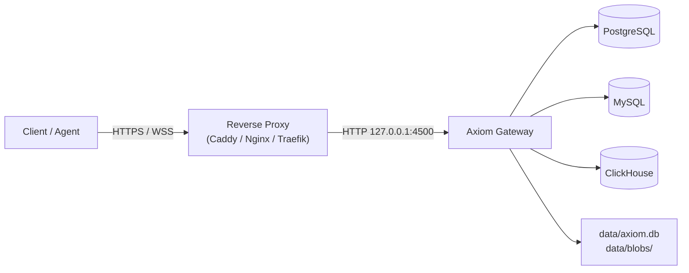

<div align="center">

# Axiom Configuration & Operations Guide

### Production Configuration Reference, Security Architecture, and Deployment Manual
**High-performance SQL Gateway · Content-Addressed Object Store · AI Agent Server**

[](https://github.com/toxichome/axiom/releases)
[](https://www.rust-lang.org)
[](../LICENSE)
[](https://github.com/toxichome/axiom/releases)

</div>

---

## Architecture & Configuration Model

Axiom maintains a strict separation between **immutable startup settings** (network bindings, thread pools, logging, memory caps) and **dynamic runtime metadata** (database connections, API keys, RBAC roles, capability tickets, and admin accounts).

```mermaid
flowchart TD
    subgraph StartupConfig["1. Startup Layer (Immutable OnceLock)"]
        A["Compiled Defaults"] --> D["Resolved AxiomConfig"]
        B["config.toml"] --> D
        C["Environment Variables (SERVER__PORT)"] --> D
    end

    subgraph DynamicStorage["2. Metadata Store (Hot-Reloadable)"]
        E[("data/axiom.db (LibSQL)")<br/>Roles, Permissions, API Keys, DBs]
        F["CLI & Web Console Mutations"] --> E
        E -->|Every 30s or on /admin/v1/reload| G["ArcSwap<Metadata> In-Memory Snapshot"]
    end

    subgraph HotDataPlane["3. High-Throughput Request Engine"]
        H["Client Request"] --> I["WAF & Dual Rate Limiter"]
        I --> J["Auth & RBAC Policy Check"]
        G -.->|Zero-Lock Constant-Time Read| J
        J --> K["Query Pipeline / Blob Shards"]
    end

    D --> HotDataPlane
```

### Precedence Hierarchy
Configuration resolves in the following order (highest to lowest priority):
1. **CLI Flags** (e.g. `axiom server run --port 4500`)
2. **Environment Variables** (e.g. `SERVER__PORT=4500` or `AXIOM_SERVER_PORT=4500`)
3. **Local `.env` File** (loaded on boot if present in execution directory)
4. **`config.toml` File** (loaded once at process launch)
5. **Compiled Defaults** (embedded fallback values)

> [!NOTE]
> Database connection strings and API keys are stored exclusively in `data/axiom.db`. They cannot be defined in `config.toml`. Configure them through the Web UI console (`/system`) or the Axiom CLI (`axiom db add`, `axiom key create`).

---

## Master `config.toml` Blueprint

Below is the complete reference configuration file with standard production values:

```toml
[server]
host = "127.0.0.1"
port = 4500
workers = 4                        # Tokio worker threads (0 = auto-detect logical CPU cores)
max_connections = 10000            # Concurrency limit for active TCP sockets
request_timeout = 30               # Global request execution timeout in seconds
body_limit = "10mb"                # Hard ceiling on single HTTP request payloads
cors_origins = ["*"]               # Permitted CORS origins (restrict in production)
trusted_proxies = ["127.0.0.1"]    # Upstream proxy IPs trusted for X-Forwarded-For headers
allowed_ips = ["127.0.0.1"]        # Exact IPs completely exempt from rate limiting
shutdown_timeout = 30              # Seconds to drain in-flight requests during SIGTERM

[logging]
enabled = true
level = "INFO"                     # Log verbosity: TRACE | DEBUG | INFO | WARN | ERROR
format = "json"                    # Log output format: "json" (production) or "pretty" (dev)
directory = "./logs"               # Output directory for rotating log files
file_prefix = "axiom"              # File naming prefix: <prefix>.<timestamp>.log
max_file_size = "50mb"             # Maximum uncompressed log segment size
max_files = 5                      # Retained historical log files before unlinking
stdout = true                      # Mirror structured log events to stdout/stderr

[metadata]
url = "file:data/axiom.db"         # Local SQLite file or remote Turso libsql URL
token = ""                         # Authentication token for remote Turso (empty for local)
reload_interval = 30               # Seconds between automatic snapshot refreshes

[rate_limit]
enabled = true
backend = "memory"                 # Rate counter backend: "memory" (L1) or "turso"
turso_url = "file:data/cache.db"   # Persistent storage file for distributed rate counters
turso_token = ""
window = 60                        # Sliding rate window in seconds
max_requests = 100                 # Maximum allowed requests per window
burst = 20                         # Permitted burst capacity above max_requests
penalty_threshold = 10             # Limit violations before source IP or key is banned
penalty_cooldown = 300             # Ban duration in seconds

[cache]
enabled = true
backend = "memory"                 # Cache storage backend: "memory" (L1) or "hybrid" (L1+L2)
turso_url = "file:data/cache.db"   # Persistent storage file for L2 cache
turso_token = ""
max_memory = "100mb"               # Upper memory ceiling for L1 DashMap cache
default_ttl = 60                   # Default cache lifetime in seconds
query_cache = true                 # Enable SELECT query result caching
idempotency_ttl = 86400            # Cache retention for Idempotency-Key responses (24 hours)
response_cache_ttl = 30            # Global HTTP response cache TTL in seconds
query_results_ttl = 5              # Cache TTL in seconds for repeated SELECT statements
negative_cache_ttl = 5             # Cache TTL in seconds for 404 / empty query results

[circuit_breaker]
enabled = true
failure_threshold = 5              # Consecutive upstream errors before opening circuit
success_threshold = 3              # Successful probes required in half-open state to close
timeout = 30                       # Cooldown seconds to wait before probing broken upstream

[blob]
path = "data/blobs"                # Filesystem root for LSM metadata and object shards
inline_max = "64kb"                # Objects <= this threshold stored inline in LSM
max_object = "5gb"                 # Maximum allowable single object upload size
verify_reads = false               # Compute and verify BLAKE3 checksums on read operations
```

---

## Detailed Parameter Specification

### `[server]` Module

| Key | Type | Default | Choices / Range | Reloadable | Description |
|---|---|---|---|---|---|
| `host` | string | `"127.0.0.1"` | Valid IPv4 / IPv6 | Startup | Local network interface to bind TCP listener. |
| `port` | integer | `4500` | 1–65535 | Startup | TCP port for incoming HTTP traffic. |
| `workers` | integer | `4` | 0–256 | Startup | Tokio runtime worker threads (`0` = auto-detect logical CPU count). |
| `max_connections` | integer | `10000` | 100–100000 | Startup | Maximum simultaneous active client connections. |
| `request_timeout` | integer | `30` | 1–300 | Startup | Global request cancellation timeout in seconds. |
| `body_limit` | string | `"10mb"` | e.g. `"2mb"`, `"50mb"` | Startup | Hard ceiling on single request payloads enforced by WAF. |
| `cors_origins` | array | `["*"]` | Origin strings | Startup | Permitted Cross-Origin Resource Sharing domains. |
| `trusted_proxies` | array | `["127.0.0.1"]` | IPv4 / CIDRs | Startup | Upstream proxies trusted to supply client IPs in `X-Forwarded-For`. |
| `allowed_ips` | array | `["127.0.0.1"]` | IPv4 / CIDRs | Startup | Source IPs entirely exempt from rate limiting and bans. |
| `shutdown_timeout` | integer | `30` | 1–120 | Startup | Grace period in seconds to finish in-flight requests on SIGTERM. |

> [!WARNING]
> Never set `trusted_proxies = ["*"]` in production. Wildcard proxy trust allows untrusted clients to spoof arbitrary IP addresses via `X-Forwarded-For`, bypassing rate limiting and ban enforcement.

---

### `[logging]` Module

| Key | Type | Default | Choices / Range | Reloadable | Description |
|---|---|---|---|---|---|
| `enabled` | boolean | `true` | `true`, `false` | Startup | Master toggle for file and terminal log emission. |
| `level` | string | `"INFO"` | `TRACE`, `DEBUG`, `INFO`, `WARN`, `ERROR` | Startup | Minimum log severity to capture. |
| `format` | string | `"json"` | `"json"`, `"pretty"` | Startup | Serialization format: structured JSON or human-readable text. |
| `directory` | string | `"./logs"` | Path | Startup | Filesystem directory where rotated logs are written. |
| `file_prefix` | string | `"axiom"` | String | Startup | Log filename prefix. |
| `max_file_size` | string | `"50mb"` | e.g. `"10mb"`, `"100mb"` | Startup | Maximum segment size before rotating active log file. |
| `max_files` | integer | `5` | 1–50 | Startup | Number of historical log files to retain before unlinking. |
| `stdout` | boolean | `true` | `true`, `false` | Startup | Mirror formatted log records directly to stdout. |

---

### `[metadata]` Module

| Key | Type | Default | Choices / Range | Reloadable | Description |
|---|---|---|---|---|---|
| `url` | string | `"file:data/axiom.db"` | Path or LibSQL URL | Startup | Metadata database target: local SQLite file or remote Turso cluster. |
| `token` | string | `""` | Auth token string | Startup | Bearer authentication token for remote Turso connection. |
| `reload_interval` | integer | `30` | 5–3600 | Startup | Interval in seconds between automatic in-memory snapshot updates. |

---

### `[rate_limit]` Module

| Key | Type | Default | Choices / Range | Reloadable | Description |
|---|---|---|---|---|---|
| `enabled` | boolean | `true` | `true`, `false` | Startup | Master toggle for dual rate limiting middleware. |
| `backend` | string | `"memory"` | `"memory"`, `"turso"` | Startup | Storage backend for rate counters (`"memory"` runs in L1 RAM). |
| `window` | integer | `60` | 1–3600 | Startup | Sliding rate limiting time window in seconds. |
| `max_requests` | integer | `100` | 1–100000 | Startup | Maximum requests permitted per window per IP or API key. |
| `burst` | integer | `20` | 0–1000 | Startup | Permitted short-term request burst above `max_requests`. |
| `penalty_threshold`| integer | `10` | 1–100 | Startup | Rate limit violations before an automatic IP/Key ban triggers. |
| `penalty_cooldown` | integer | `300` | 10–86400 | Startup | Duration in seconds that a banned entity remains blocked. |

---

### `[cache]` Module

| Key | Type | Default | Choices / Range | Reloadable | Description |
|---|---|---|---|---|---|
| `enabled` | boolean | `true` | `true`, `false` | Startup | Master toggle for internal response and query cache engine. |
| `backend` | string | `"memory"` | `"memory"`, `"hybrid"` | Startup | Storage layer: volatile RAM L1 or disk-backed L1+L2 hybrid. |
| `max_memory` | string | `"100mb"` | e.g. `"256mb"`, `"1gb"` | Startup | Memory allocation ceiling for L1 DashMap cache. |
| `default_ttl` | integer | `60` | 1–86400 | Startup | Default cache lifetime in seconds when not specified. |
| `query_cache` | boolean | `true` | `true`, `false` | Startup | Cache parameterized SQL `SELECT` statement results. |
| `idempotency_ttl` | integer | `86400` | 60–604800 | Startup | Cache retention in seconds for `Idempotency-Key` write mutations. |
| `query_results_ttl`| integer | `5` | 1–300 | Startup | Cache lifetime in seconds for hot repeated database queries. |
| `negative_cache_ttl`| integer | `5` | 1–60 | Startup | Cache lifetime in seconds for empty responses and 404 lookups. |

---

### `[circuit_breaker]` Module

| Key | Type | Default | Choices / Range | Reloadable | Description |
|---|---|---|---|---|---|
| `enabled` | boolean | `true` | `true`, `false` | Startup | Master toggle for upstream database fault isolation. |
| `failure_threshold`| integer | `5` | 1–50 | Startup | Consecutive upstream connection errors before opening circuit. |
| `success_threshold`| integer | `3` | 1–20 | Startup | Successful probes in half-open state required to close circuit. |
| `timeout` | integer | `30` | 1–300 | Startup | Recovery cooldown in seconds before testing half-open probe. |

---

### `[blob]` Module

| Key | Type | Default | Choices / Range | Reloadable | Description |
|---|---|---|---|---|---|
| `path` | string | `"data/blobs"` | Local filesystem path | Startup | Directory root for LSM index, shard journals, and blob objects. |
| `inline_max` | string | `"64kb"` | `"4kb"`–`"1mb"` | Startup | Payloads `<= this size` stored directly in LSM tree. |
| `max_object` | string | `"5gb"` | `"100mb"`–`"50gb"` | Startup | Absolute upper limit on a single object upload. |
| `verify_reads` | boolean | `false` | `true`, `false` | Startup | Recalculate BLAKE3 hashes on every read (increases CPU load). |

---

## Environment Variable Overrides

Every configuration parameter can be overridden using environment variables at process launch. Delimit nested configuration sections using either a double underscore (`__`) or single underscore:

```bash
# Override server binding and worker count
export SERVER__HOST="0.0.0.0"
export SERVER__PORT="8080"
export SERVER__WORKERS="8"

# Override database metadata store for Turso cluster
export METADATA__URL="libsql://primary.turso.io"
export METADATA__TOKEN="eyJhbGciOi..."

# Override cache and logging
export LOGGING__LEVEL="WARN"
export CACHE__MAX_MEMORY="512mb"
```

---

## Hardware Sizing & Memory Profiles

Axiom compiles to a single, lightweight binary that scales predictably across different deployment tiers:

| Profile | Workers | Cache Backend | L1 RAM Cap | Logging | Target Idle RSS | Target Peak Throughput | Recommended Host |
|---|---|---|---|---|---|---|---|
| **Minimal** | 1 | Memory | 32 MB | Off / Error | `< 10 MB` | 5,000 req/s | Shared VPS, Raspberry Pi, cPanel |
| **Standard** | 4 | Memory | 100 MB | JSON / Info | `< 25 MB` | 25,000 req/s | 2 vCPU / 2 GB RAM Instance |
| **Production** | 8 | Hybrid | 256 MB | JSON / Info | `< 50 MB` | 75,000 req/s | 4 vCPU / 4 GB Dedicated Server |
| **Enterprise** | Auto | Hybrid | 1 GB+ | JSON + OTel | `< 150 MB` | 150,000+ req/s | Multi-core Bare Metal Server |

---

## Production Deployment Recipes

### Recommended Topology

Axiom serves HTTP on `127.0.0.1:4500` by default. Place Axiom behind a modern reverse proxy that handles public TLS termination, HTTP/2 or HTTP/3 multiplexing, and compression:



---

### 1. Caddyfile (Automatic Let's Encrypt HTTPS)

```caddyfile
api.example.com {
    encode zstd gzip

    # Proxy to local Axiom gateway
    reverse_proxy 127.0.0.1:4500 {
        header_up X-Forwarded-Proto {scheme}
        header_up X-Real-IP {remote_host}
    }
}
```

---

### 2. Nginx Configuration

```nginx
upstream axiom_backend {
    server 127.0.0.1:4500;
    keepalive 64;
}

server {
    listen 443 ssl http2;
    server_name api.example.com;

    ssl_certificate /etc/letsencrypt/live/api.example.com/fullchain.pem;
    ssl_certificate_key /etc/letsencrypt/live/api.example.com/privkey.pem;
    ssl_protocols TLSv1.2 TLSv1.3;
    ssl_ciphers HIGH:!aNULL:!MD5;

    # Support large blob uploads up to 5 GB
    client_max_body_size 5G;

    location / {
        proxy_pass http://axiom_backend;
        proxy_http_version 1.1;
        proxy_set_header Connection "";
        proxy_set_header Host $host;
        proxy_set_header X-Real-IP $remote_addr;
        proxy_set_header X-Forwarded-For $proxy_add_x_forwarded_for;
        proxy_set_header X-Forwarded-Proto $scheme;

        # Disable buffering for chunked streaming and SSE
        proxy_buffering off;
        proxy_read_timeout 300s;
    }
}
```

---

### 3. Hardened Systemd Service

Create `/etc/systemd/system/axiom.service`:

```ini
[Unit]
Description=Axiom Database Gateway & Storage Engine
After=network.target remote-fs.target
Documentation=https://github.com/toxichome/axiom

[Service]
Type=simple
User=axiom
Group=axiom
WorkingDirectory=/opt/axiom
ExecStart=/opt/axiom/axiom server run
Restart=always
RestartSec=3s

# Security Hardening Directives
ProtectSystem=strict
ProtectHome=true
PrivateTmp=true
NoNewPrivileges=true
ProtectKernelTunables=true
ProtectControlGroups=true
ReadWritePaths=/opt/axiom/data /opt/axiom/logs
LimitNOFILE=65536

[Install]
WantedBy=multi-user.target
```

Enable and start the service:
```bash
sudo systemctl daemon-reload
sudo systemctl enable --now axiom
sudo systemctl status axiom
```

---

### 4. Docker Compose Setup

```yaml
version: "3.8"

services:
  axiom:
    image: ghcr.io/toxichome/axiom:0.1.11
    container_name: axiom
    restart: unless-stopped
    ports:
      - "127.0.0.1:4500:4500"
    environment:
      - SERVER__HOST=0.0.0.0
      - SERVER__PORT=4500
      - LOGGING__FORMAT=json
    volumes:
      - ./config.toml:/opt/axiom/config.toml:ro
      - ./data:/opt/axiom/data
      - ./logs:/opt/axiom/logs
    healthcheck:
      test: ["CMD", "curl", "-f", "http://127.0.0.1:4500/health"]
      interval: 10s
      timeout: 3s
      retries: 3
```

---

## Backup & Disaster Recovery

Axiom isolates all dynamic state into two physical directories:

| Asset | Location | Storage Type | Backup Strategy |
|---|---|---|---|
| **Metadata Store** | `data/axiom.db` | SQLite / LibSQL WAL | Hot backup via `sqlite3 data/axiom.db ".backup 'backup.db'"` or file copy |
| **Blob Engine** | `data/blobs/` | LSM Index + Content Shards | Incremental file rsync / disk snapshot |
| **Server Config** | `config.toml` | TOML File | Version-controlled configuration repository |

### Safe Backup Script
```bash
#!/usr/bin/env bash
set -euo pipefail

BACKUP_DIR="/backups/axiom-$(date +%Y%m%d_%H%M%S)"
mkdir -p "$BACKUP_DIR"

# 1. Hot-backup the metadata database using SQLite WAL backup API
sqlite3 /opt/axiom/data/axiom.db ".backup '$BACKUP_DIR/axiom.db'"

# 2. Archive blob shards with preserved hardlinks and file timestamps
rsync -a --delete /opt/axiom/data/blobs/ "$BACKUP_DIR/blobs/"

# 3. Archive static configuration
cp /opt/axiom/config.toml "$BACKUP_DIR/config.toml"

echo "Axiom backup successfully created at $BACKUP_DIR"
```

---

Maintained by [Toxichome](https://toxichome.cc). Licensed under the [MIT License](../LICENSE).
