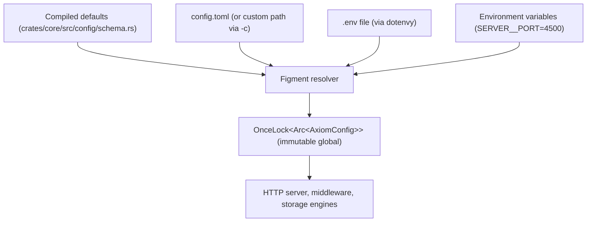

<div align="center">

# Axiom Configuration Reference (`config.toml`)

### Startup Settings, Modules, Defaults, and Environment Overrides

**Single Binary Gateway · Immutable Startup Configuration · Lock-Free Arc Access**

[](https://github.com/toxichome-whoami/axiom/releases)
[](https://www.rust-lang.org)
[](../LICENSE)
[](https://github.com/toxichome-whoami/axiom/releases)

</div>

## Contents

1. [Overview](#1-overview)
2. [Quick Start](#2-quick-start)
3. [Configuration Model & Precedence](#3-configuration-model--precedence)
4. [File Discovery & CLI Tools](#4-file-discovery--cli-tools)
5. [Full `config.toml` Blueprint](#5-full-configtoml-blueprint)
6. [Module Reference](#6-module-reference)
7. [Environment Variable Overrides](#7-environment-variable-overrides)
8. [Production Checklist](#8-production-checklist)

## 1. Overview

`config.toml` holds **process-level startup configuration only**: network binding, worker threads, logging, caches, circuit breakers, and storage roots.

| Lives in `config.toml`              | Lives in the metadata database (`data/axiom.db`) |
| ----------------------------------- | ------------------------------------------------ |
| Host, port, TLS, timeouts           | Database connection pools                        |
| Logging, rate-limit, cache tuning   | API keys                                         |
| Circuit breaker, blob storage paths | RBAC roles                                       |
| Metadata store location             | Cluster mesh peers                               |

> [!IMPORTANT]
> Database connections, API keys, roles, and cluster peers **cannot** be set in `config.toml`. Manage them with the Admin Web UI (`/system`), the [CLI Reference](./cli.md) (`axiom db`, `axiom key`, `axiom role`, `axiom cluster`), or the [Admin REST API](./api.md).

**Value formats used throughout this document**

| Kind      | Format              | Examples                    |
| --------- | ------------------- | --------------------------- |
| Durations | Integer **seconds** | `30`, `86400`               |
| Sizes     | String with unit    | `"10mb"`, `"5gb"`, `"64kb"` |
| Toggles   | Boolean             | `true`, `false`             |

## 2. Quick Start

Axiom runs with **no config file at all**: it boots on compiled defaults and binds to `127.0.0.1:4500`.

```bash
axiom config init            # write a config.toml with defaults
axiom config show            # validate and print resolved values
axiom server run             # start (reads ./config.toml)
```

Most common first change: expose the server beyond localhost.

```toml
[server]
host = "0.0.0.0"
```

or, without editing the file: `SERVER__HOST=0.0.0.0 axiom server run`

## 3. Configuration Model & Precedence



### Precedence (highest wins)

| Priority | Source                                  | Example                |
| -------- | --------------------------------------- | ---------------------- |
| 1        | Environment variables                   | `SERVER__PORT=4500`    |
| 2        | `.env` file in the working directory    | `SERVER__PORT=4500`    |
| 3        | `config.toml` (or custom path via `-c`) | `[server] port = 4500` |
| 4        | Compiled defaults                       | `port = 4500`          |

### Runtime guarantees

- **Immutable.** Configuration is read once at startup and frozen. **Changing it requires a restart.**
- **Lock-free.** Handlers read config through `Arc` clones with no mutex contention.
- **Not the same as `/admin/v1/reload`.** That endpoint refreshes the _metadata_ snapshot (keys, roles, pools) from disk. It never re-reads `config.toml`.

## 4. File Discovery & CLI Tools

**Default:** `axiom server run` looks for `config.toml` in the current working directory.

**Custom path:**

```bash
axiom server run -c /etc/axiom/production.toml
```

**`axiom config` subcommands**

| Command               | Purpose                                                                                    |
| --------------------- | ------------------------------------------------------------------------------------------ |
| `axiom config init`   | Create `config.toml` with standard defaults (`-p` path, `-f` force, `--to-env`)            |
| `axiom config to-env` | Convert `config.toml` into a `.env` environment file (`-i` input, `-o` output, `-f` force) |
| `axiom config show`   | Validate and inspect configuration values from `config.toml` (`-c` path)                   |

> Run `axiom config show` to validate syntax and inspect active TOML configuration values.

## 5. Full `config.toml` Blueprint

Every module, key, and default. Copy what you need; omitted keys fall back to defaults.

```toml
# ==============================================================================
# Axiom Master Configuration (config.toml)
# All changes require a server restart to take effect.
# ==============================================================================

# --- Server & Network ---
[server]
host = "127.0.0.1"                 # TCP interface to bind
port = 4500                        # TCP port for HTTP traffic
workers = 0                        # Tokio worker threads (0 = auto-detect CPU cores)
max_connections = 10000            # Ceiling for simultaneous TCP sockets
request_timeout = 30               # Global request timeout (seconds)
body_limit = "10mb"                # Max single HTTP request payload
tls_cert = ""                      # TLS certificate PEM path (empty = plain HTTP)
tls_key = ""                       # TLS private key PEM path
allowed_ips = ["127.0.0.1"]        # Client IPs exempt from rate limits and bans
trusted_proxies = ["127.0.0.1"]    # Proxy IPs trusted for X-Forwarded-For
cors_origins = ["*"]               # Allowed CORS origins
shutdown_timeout = 30              # Grace period to drain in-flight requests (seconds)

# --- Structured Logging ---
[logging]
enabled = true                     # Master toggle for log emission
level = "INFO"                     # "TRACE" | "DEBUG" | "INFO" | "WARN" | "ERROR"
format = "json"                    # "json" (production) or "pretty" (development)
directory = "./logs"               # Output directory for rotating log files
file_prefix = "axiom"              # Files are named <prefix>.<timestamp>.log
max_file_size = "50mb"             # Size at which the active log file rotates
max_files = 5                      # Rotated files to retain
stdout = true                      # Mirror log records to stdout

# --- Rate Limiting & Abuse Defense ---
[rate_limit]
enabled = true                     # Master toggle
backend = "memory"                 # "memory" (L1 RAM) or "turso" (persistent)
turso_url = "file:data/cache.db"   # Storage location when backend = "turso"
turso_token = ""                   # Remote Turso auth token, if applicable
window = 60                        # Sliding window (seconds)
max_requests = 100                 # Requests allowed per window (per IP and per API key)
burst = 20                         # Short-term burst allowance above max_requests
penalty_threshold = 10             # Violations before an automatic ban
penalty_cooldown = 300             # Ban duration (seconds)

# --- Response & Query Caching ---
[cache]
enabled = true                     # Master toggle
backend = "memory"                 # "memory" (L1 RAM) or "hybrid" (L1 + L2 disk)
turso_url = "file:data/cache.db"   # L2 location when backend = "hybrid"
turso_token = ""                   # Remote Turso auth token, if applicable
max_memory = "100mb"               # L1 DashMap memory ceiling
default_ttl = 60                   # Default cache lifetime (seconds)
query_cache = true                 # Cache SELECT results and parsed ASTs
idempotency_ttl = 86400            # Retention for Idempotency-Key responses (24h)
response_cache_ttl = 30            # TTL for cached GET responses (seconds)
query_results_ttl = 5              # TTL for repeated SELECT results (seconds)
negative_cache_ttl = 5             # TTL for 404 / empty lookups (seconds)

# --- Low-Level Performance ---
[performance]
query_cache_size = 2048            # Slots for parsed SQL ASTs
transpiler_cache_size = 4096       # Slots for SQL dialect transpilation results
rate_limit_cache_size = 256        # Slots for rate-limit identity lookups

# --- Database Circuit Breaker ---
[circuit_breaker]
enabled = true                     # Upstream fault isolation toggle
failure_threshold = 5              # Consecutive errors before the circuit opens
success_threshold = 3              # Successful probes in HALF-OPEN to close it
timeout = 30                       # Cooldown before probing a broken upstream (seconds)

# --- Metadata Store (LibSQL / SQLite) ---
[metadata]
url = "file:data/axiom.db"         # Local SQLite file or remote libsql:// URL
token = ""                         # Bearer token for remote Turso
reload_interval = 30               # Seconds between in-memory snapshot refreshes

# --- Content-Addressed Blob Storage ---
[blob]
path = "data/blobs"                # Root for LSM index and blob shards
inline_max = "64kb"                # Payloads <= this are stored inline in the Fjall LSM
max_object = "5gb"                 # Max single object / multipart upload size
verify_reads = false               # Recompute BLAKE3 on every read
```

## 6. Module Reference

### 6.1 `[server]`: network, limits, TLS, CORS

| Key                | Type        | Default                | Range / values        | Description                                                                                            |
| ------------------ | ----------- | ---------------------- | --------------------- | ------------------------------------------------------------------------------------------------------ |
| `host`             | string      | `"127.0.0.1"`          | IPv4 or IPv6          | Interface to bind. `"0.0.0.0"` listens on all interfaces.                                              |
| `port`             | integer     | `4500`                 | `1`–`65535`           | HTTP listen port.                                                                                      |
| `workers`          | integer     | `0`                    | `0`–`256`             | Tokio worker threads. `0` = one per logical CPU.                                                       |
| `max_connections`  | integer     | `10000`                | `100`–`100000`        | Concurrent TCP connection ceiling.                                                                     |
| `request_timeout`  | integer (s) | `30`                   | `1`–`300`             | Cancels requests that run longer than this.                                                            |
| `body_limit`       | size        | `"10mb"`               | e.g. `"2mb"`, `"1gb"` | Max request body, enforced by the WAF.                                                                 |
| `tls_cert`         | path        | `""`                   | PEM file              | Certificate for native TLS. Empty disables TLS.                                                        |
| `tls_key`          | path        | `""`                   | PEM file              | Private key matching `tls_cert`.                                                                       |
| `allowed_ips`      | string[]    | `[]` / `["127.0.0.1"]` | Exact IPs or CIDR     | Exempt from rate limiting and auto-bans (`[]` compiled default; `init` template uses `["127.0.0.1"]`). |
| `trusted_proxies`  | string[]    | `["127.0.0.1"]`        | IPs or CIDR           | Proxies whose `X-Forwarded-For` is believed.                                                           |
| `cors_origins`     | string[]    | `[]` / `["*"]`         | Origins or `"*"`      | Allowed CORS origins (`[]` compiled default allows local dev ports; `init` template uses `["*"]`).     |
| `shutdown_timeout` | integer (s) | `30`                   | `1`–`120`             | Drain period on SIGTERM / SIGINT.                                                                      |

> [!WARNING]
> **Never set `trusted_proxies = ["*"]` in production.** It lets any client forge `X-Forwarded-For`, bypassing IP rate limits and bans. List only your real proxy or load-balancer addresses.

> [!NOTE]
> Set `tls_cert` and `tls_key` together. If you terminate TLS at a reverse proxy instead, leave both empty and set `trusted_proxies` to the proxy's address.

### 6.2 `[logging]`

| Key             | Type    | Default    | Range / values                        | Description                                         |
| --------------- | ------- | ---------- | ------------------------------------- | --------------------------------------------------- |
| `enabled`       | bool    | `true`     |                                       | Master toggle for log output.                       |
| `level`         | string  | `"INFO"`   | `TRACE` `DEBUG` `INFO` `WARN` `ERROR` | Minimum severity captured.                          |
| `format`        | string  | `"json"`   | `json`, `pretty`                      | `json` for log aggregators, `pretty` for local dev. |
| `directory`     | path    | `"./logs"` |                                       | Log directory (created if missing).                 |
| `file_prefix`   | string  | `"axiom"`  |                                       | Files named `<prefix>.<timestamp>.log`.             |
| `max_file_size` | size    | `"50mb"`   | e.g. `"10mb"`                         | Rotate when the active file reaches this size.      |
| `max_files`     | integer | `5`        | `1`–`50`                              | Rotated segments kept; the oldest is deleted first. |
| `stdout`        | bool    | `true`     |                                       | Also write logs to stdout/stderr.                   |

> In containers, keep `stdout = true` and `format = "json"` so your runtime's log collector picks up records.

### 6.3 `[rate_limit]`

Limits apply **per IP and per API key**. IPs in `server.allowed_ips` are exempt.

| Key                 | Type        | Default                | Range / values     | Description                                                        |
| ------------------- | ----------- | ---------------------- | ------------------ | ------------------------------------------------------------------ |
| `enabled`           | bool        | `true`                 |                    | Master toggle.                                                     |
| `backend`           | string      | `"memory"`             | `memory`, `turso`  | `memory` is fast but resets on restart; `turso` persists counters. |
| `turso_url`         | string      | `"file:data/cache.db"` | path or LibSQL URL | Used only when `backend = "turso"`.                                |
| `turso_token`       | string      | `""`                   |                    | Auth token for a remote Turso instance.                            |
| `window`            | integer (s) | `60`                   | `1`–`3600`         | Sliding window length.                                             |
| `max_requests`      | integer     | `100`                  | `1`–`100000`       | Requests per window.                                               |
| `burst`             | integer     | `20`                   | `0`–`1000`         | Extra capacity above `max_requests` for short spikes.              |
| `penalty_threshold` | integer     | `10`                   | `1`–`100`          | Violations before an automatic ban.                                |
| `penalty_cooldown`  | integer (s) | `300`                  | `10`–`86400`       | How long a ban lasts.                                              |

**How it behaves with defaults:** a client may make 100 requests per 60 s (plus a burst of 20). After 10 violations it is blocked for 5 minutes. Exceeding limits returns `429 RATE_LIMITED`.

### 6.4 `[cache]`

| Key                  | Type        | Default                | Range / values     | Description                                            |
| -------------------- | ----------- | ---------------------- | ------------------ | ------------------------------------------------------ |
| `enabled`            | bool        | `true`                 |                    | Master toggle.                                         |
| `backend`            | string      | `"memory"`             | `memory`, `hybrid` | `hybrid` adds an L2 disk tier behind the L1 RAM cache. |
| `turso_url`          | string      | `"file:data/cache.db"` | path or LibSQL URL | L2 location when `backend = "hybrid"`.                 |
| `turso_token`        | string      | `""`                   |                    | Auth token for a remote L2 instance.                   |
| `max_memory`         | size        | `"100mb"`              | e.g. `"512mb"`     | L1 memory ceiling.                                     |
| `default_ttl`        | integer (s) | `60`                   | `1`–`86400`        | Default lifetime for general items.                    |
| `query_cache`        | bool        | `true`                 |                    | Cache SELECT results and parsed ASTs.                  |
| `idempotency_ttl`    | integer (s) | `86400`                | `60`–`604800`      | How long `Idempotency-Key` responses are replayable.   |
| `response_cache_ttl` | integer (s) | `30`                   | `1`–`3600`         | TTL for cached GET responses.                          |
| `query_results_ttl`  | integer (s) | `5`                    | `1`–`300`          | TTL for repeated SELECT results.                       |
| `negative_cache_ttl` | integer (s) | `5`                    | `1`–`60`           | TTL for 404 and empty lookups.                         |

> [!TIP]
> Cached responses report `"cached": true` in the response `meta`. Flush all caches at runtime with `POST /admin/v1/cache/flush`; no restart is needed.

### 6.5 `[performance]`

| Key                     | Type    | Default | Range         | Description                              |
| ----------------------- | ------- | ------- | ------------- | ---------------------------------------- |
| `query_cache_size`      | integer | `2048`  | `128`–`65536` | LRU slots for parsed SQL ASTs.           |
| `transpiler_cache_size` | integer | `4096`  | `128`–`65536` | Slots for dialect transpilation results. |
| `rate_limit_cache_size` | integer | `256`   | `16`–`4096`   | Slots for rate-limit identity lookups.   |

Defaults suit most deployments. Raise the first two only if you run a very large variety of distinct queries.

### 6.6 `[circuit_breaker]`

Stops a failing upstream database from exhausting worker threads.

```text
CLOSED ──(failure_threshold consecutive errors)──▶ OPEN
OPEN ──(after timeout seconds)──▶ HALF-OPEN
HALF-OPEN ──(success_threshold successes)──▶ CLOSED
HALF-OPEN ──(any failure)──▶ OPEN
```

| Key                 | Type        | Default | Range     | Description                                                       |
| ------------------- | ----------- | ------- | --------- | ----------------------------------------------------------------- |
| `enabled`           | bool        | `true`  |           | Master toggle.                                                    |
| `failure_threshold` | integer     | `5`     | `1`–`50`  | Consecutive errors before the circuit opens (requests fail fast). |
| `success_threshold` | integer     | `3`     | `1`–`20`  | Successful probes needed in HALF-OPEN to close.                   |
| `timeout`           | integer (s) | `30`    | `1`–`300` | Cooldown before probing recovery.                                 |

### 6.7 `[metadata]`

The store behind API keys, users, roles, and database pools.

| Key               | Type        | Default                | Range / values                | Description                                              |
| ----------------- | ----------- | ---------------------- | ----------------------------- | -------------------------------------------------------- |
| `url`             | string      | `"file:data/axiom.db"` | `file:path` or `libsql://...` | Local SQLite file or remote Turso.                       |
| `token`           | string      | `""`                   |                               | Bearer token for remote Turso.                           |
| `reload_interval` | integer (s) | `30`                   | `5`–`3600`                    | Interval between automatic in-memory snapshot refreshes. |

> Changes made through the CLI or Admin API reach running request handlers within `reload_interval` seconds, or immediately via `POST /admin/v1/reload`.

### 6.8 `[blob]`

| Key            | Type | Default        | Range / values     | Description                                               |
| -------------- | ---- | -------------- | ------------------ | --------------------------------------------------------- |
| `path`         | path | `"data/blobs"` |                    | Root for the LSM index and disk shards.                   |
| `inline_max`   | size | `"64kb"`       | `"4kb"`–`"1mb"`    | Payloads at or below this size live inside the Fjall LSM. |
| `max_object`   | size | `"5gb"`        | `"100mb"`–`"50gb"` | Max single object or multipart upload.                    |
| `verify_reads` | bool | `false`        |                    | Recompute BLAKE3 on every read. Safer, but costs CPU.     |

> [!NOTE]
> Without `verify_reads`, integrity is checked on demand via `POST /api/v1/blobs/objects/:ns/verify/*key` (single object) or `POST /admin/v1/blobs/scrub` (cluster-wide).

## 7. Environment Variable Overrides

Every key can be overridden with:

```text
<SECTION>__<KEY>=<VALUE>        # uppercase, double underscore
```

| Variable             | TOML key            | Example                |
| -------------------- | ------------------- | ---------------------- |
| `SERVER__HOST`       | `server.host`       | `0.0.0.0`              |
| `SERVER__PORT`       | `server.port`       | `8080`                 |
| `SERVER__WORKERS`    | `server.workers`    | `8`                    |
| `SERVER__BODY_LIMIT` | `server.body_limit` | `50mb`                 |
| `LOGGING__LEVEL`     | `logging.level`     | `WARN`                 |
| `LOGGING__FORMAT`    | `logging.format`    | `json`                 |
| `METADATA__URL`      | `metadata.url`      | `libsql://db.turso.io` |
| `METADATA__TOKEN`    | `metadata.token`    | `eyJhbGciOi...`        |
| `CACHE__MAX_MEMORY`  | `cache.max_memory`  | `256mb`                |
| `BLOB__PATH`         | `blob.path`         | `/mnt/storage/blobs`   |

These are examples; the same pattern works for all keys. Run `axiom config to-env` for the complete list.

> [!TIP]
> Put secrets (`METADATA__TOKEN`, `RATE_LIMIT__TURSO_TOKEN`, `CACHE__TURSO_TOKEN`) in environment variables or your orchestrator's secret store rather than in a committed `config.toml`.

### Docker

```bash
docker run -d \
  -p 4500:4500 \
  -e SERVER__HOST=0.0.0.0 \
  -e SERVER__PORT=4500 \
  -e LOGGING__FORMAT=json \
  -e METADATA__URL=file:/app/data/axiom.db \
  -v axiom_data:/app/data \
  --name axiom \
  ghcr.io/toxichome-whoami/axiom:0.1.19
```

### Docker Compose

```yaml
services:
  axiom:
    image: ghcr.io/toxichome-whoami/axiom:0.1.19
    ports:
      - "4500:4500"
    environment:
      SERVER__HOST: "0.0.0.0"
      LOGGING__FORMAT: "json"
      METADATA__URL: "file:/app/data/axiom.db"
      BLOB__PATH: "/app/data/blobs"
    volumes:
      - axiom_data:/app/data
    restart: unless-stopped

volumes:
  axiom_data:
```

> Point `METADATA__URL` and `BLOB__PATH` at the mounted volume; otherwise keys, roles, and blobs are lost when the container is replaced.

## 8. Production Checklist

| Done | Setting                                                                    | Why                                     |
| ---- | -------------------------------------------------------------------------- | --------------------------------------- |
| [ ]  | `server.host` set deliberately (`0.0.0.0` only behind a firewall or proxy) | Avoid unintended exposure               |
| [ ]  | TLS enabled (`tls_cert` / `tls_key`) or terminated at a proxy              | Protect API keys in transit             |
| [ ]  | `cors_origins` limited to your app origins (not `["*"]`)                   | Block unwanted browser origins          |
| [ ]  | `trusted_proxies` lists only your real proxies                             | Prevent `X-Forwarded-For` spoofing      |
| [ ]  | `allowed_ips` kept minimal                                                 | Exempt IPs bypass rate limits and bans  |
| [ ]  | `logging.format = "json"`, `level = "INFO"` or `"WARN"`                    | Machine-readable, low noise             |
| [ ]  | `metadata.url`, `blob.path`, and `data/` on persistent storage             | Survive restarts and redeploys          |
| [ ]  | `body_limit` and `blob.max_object` sized for your workloads                | Reject oversize uploads early           |
| [ ]  | Tokens supplied via environment or secrets                                 | Keep credentials out of version control |
| [ ]  | `axiom config show` reviewed after deploy                                  | Confirm the effective values            |

**Minimal production example**

```toml
[server]
host = "0.0.0.0"
cors_origins = ["https://app.example.com"]
trusted_proxies = ["10.0.0.5"]
tls_cert = "/etc/axiom/tls/cert.pem"
tls_key  = "/etc/axiom/tls/key.pem"

[logging]
level = "WARN"

[rate_limit]
max_requests = 300
```
