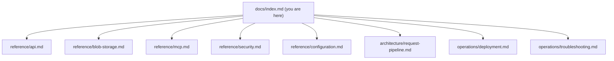

# Axiom docs hub

**Find anything in under 30 seconds.** Pick your path below — every page follows the same rhythm: *what → how → options → how it works.*

---

## Start here

| I want to… | Go to |
|---|---|
| Run Axiom in 5 minutes | [README quick start](../README.md#-quick-start-5-minutes) |
| Understand a request end-to-end | [Request pipeline](./architecture/request-pipeline.md) |
| Call the REST API | [API reference](./reference/api.md) |
| Store files / presigned URLs | [Blob storage](./reference/blob-storage.md) |
| Let an AI agent use Axiom | [MCP reference](./reference/mcp.md) |
| Configure / deploy securely | [Configuration](./reference/configuration.md) · [Deployment](./operations/deployment.md) |
| Fix an error code | [Troubleshooting](./operations/troubleshooting.md) |
| Review the threat model | [Security](./reference/security.md) |

---

## Reading paths

- **App developer:** README → [API](./reference/api.md) → [Blobs](./reference/blob-storage.md) → [Troubleshooting](./operations/troubleshooting.md).
- **Platform / ops:** [Configuration](./reference/configuration.md) → [Deployment](./operations/deployment.md) → [Security](./reference/security.md) → [Troubleshooting](./operations/troubleshooting.md).
- **AI / agent builder:** [MCP](./reference/mcp.md) → [API](./reference/api.md) → [Security](./reference/security.md).
- **Reviewer / auditor:** [Security](./reference/security.md) → [Pipeline](./architecture/request-pipeline.md).

---

## Conventions used across these docs

- Sentence-case headings, max 3 levels. Tables for 3+ attributes. Every concept has a runnable example.
- `file_path:line_number` links point at the real implementation (e.g. `crates/api/src/middleware/waf.rs:100`).
- Mermaid diagrams render on GitHub/GitLab without plugins.
- Warnings and breaking changes live at the **top** of the page, never buried.

## Machine-readable map

- [`llms.txt`](./llms.txt) — one-page index for crawlers and coding agents.
