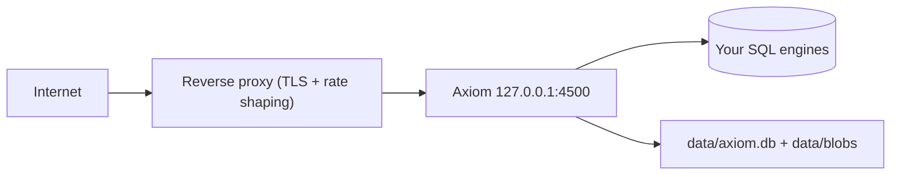

<div align="center">

# Deployment guide

**Bind local, terminate TLS at the edge, pin your origins.** Axiom serves plain HTTP — the proxy in front does the hardening.

</div>

---

## Contents

- [Topology](#topology)
- [Production checklist](#production-checklist)
- [Reverse proxy](#reverse-proxy-caddy--nginx--apache)
- [TLS](#tls)
- [Files & backups](#files--backups)

---

## Topology



## Production checklist

| # | Action | Where |
|---|---|---|
| 1 | Bind `host = "127.0.0.1"`, never `0.0.0.0` without a firewall | `[server]` |
| 2 | `cors_origins = ["https://app.example.com"]` (default `[]` = same-origin) | `[server]` |
| 3 | `trusted_proxies = ["<proxy IP>"]` — never `"*"` | `[server]` |
| 4 | `allowed_ips` = exact IPs only (no `host:port`, `*` only at octet boundary) | `[server]` |
| 5 | `body_limit = "10 MB"` (non-blob); `blob.max_object` as low as you can tolerate | `[server]` / `[blob]` |
| 6 | Strong `blob.ticket_secret` (tickets die on restart if empty) | `[blob]` |
| 7 | `chmod 600 config.toml data/axiom.db`; back up both | OS |
| 8 | Force HTTPS at the proxy; HSTS only takes effect over TLS | proxy |
| 9 | Ship logs (`json` format) + alert on `WAF_*`, `BANNED`, `RATE_LIMIT_EXCEEDED` | `[logging]` |

## Reverse proxy (Caddy / Nginx / Apache)

**Caddy** (simplest — automatic HTTPS):

```
axiom.example.com {
    reverse_proxy 127.0.0.1:4500
}
```

**Nginx:**

```nginx
server {
    listen 443 ssl;
    server_name axiom.example.com;
    location / {
        proxy_pass http://127.0.0.1:4500;
        proxy_set_header X-Forwarded-For $proxy_add_x_forwarded_for;
        proxy_set_header X-Forwarded-Proto https;
    }
}
```

**Apache:** a starter `.htaccess` ships in the repo root — it forces HTTPS, proxies to `127.0.0.1:4500`, denies `*.toml/*.db/*.sqlite*/*.bak/*.swp`, blocks internal folders (`crates/ target/ ui/ tests/ …`) with `403`, and sets `nosniff`/`DENY`/`Referrer-Policy`/`Permissions-Policy` (HSTS only over HTTPS).

> Set `trusted_proxies` to the proxy's IP so `X-Forwarded-For` can't be spoofed, and forward the real client IP.

## TLS

Axiom has `tls_cert`/`tls_key` Precisely for direct-TLS experiments — **prefer proxy termination** in production. Either way, never serve API keys over plaintext: session cookies carry no `Secure` flag unless the request arrives as HTTPS.

## Files & backups

- `data/axiom.db` — keys, roles, DB aliases, sessions. Back up; restrict to `0600`.
- `data/blobs/` — LSM index + content. Back up together with `axiom.db`.
- `config.toml` — may contain legacy secrets on first boot; `0600`.
- `logs/` — JSON lines; `RUST_LOG=axiom=debug` without restart for triage.
- Multi-node: point every node at the same remote Turso `metadata.url`; bans/rate counters are per-process (see [Security](../reference/security.md)).
