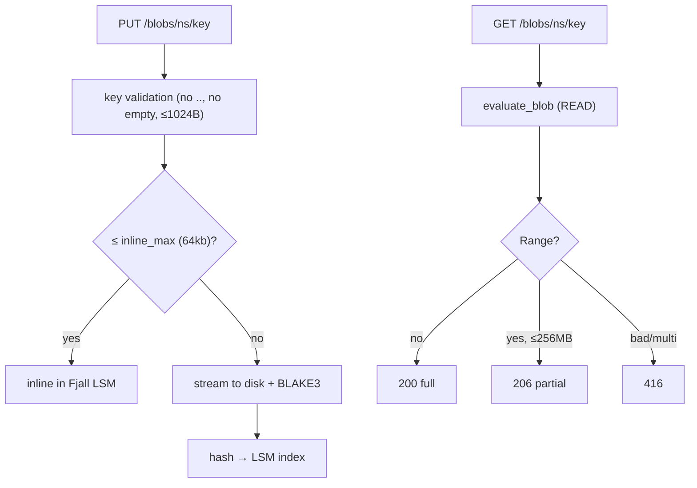

<div align="center">

# Blob storage guide

**Content-addressed files with presigned URLs, range reads, and multipart uploads.** BLAKE3 outside, Fjall LSM inside.

</div>

---

> **Limits that bite:** single range ≤ 256 MB (`416` otherwise) · tickets 60–86400 s, `READ`/`WRITE` only · `DELETE` never ticket-scoped · `max_object` default 5 GB.

## Contents

- [Tasks](#tasks)
- [Tickets](#tickets-capability-urls)
- [Ranges & caching](#ranges--caching)
- [Multipart uploads](#multipart-uploads)
- [How it works](#how-it-works)

---

## Tasks

### Upload / download

```bash
KEY=$(echo -n "mykey:my-secret" | base64)

# Upload (Content-Type stored with the object)
curl -X PUT "http://localhost:4500/api/v1/blobs/media/avatars/u1.png" \
  -H "X-Axiom-Key: $KEY" -H "Content-Type: image/png" \
  --data-binary "@avatar.png"

# Download (full)
curl "http://localhost:4500/api/v1/blobs/media/avatars/u1.png" \
  -H "X-Axiom-Key: $KEY" -o out.png

# Download (partial — any single range up to 256 MB)
curl -H "Range: bytes=0-1048575" \
  -H "X-Axiom-Key: $KEY" \
  "http://localhost:4500/api/v1/blobs/media/avatars/u1.png" -o part.bin
# → 206 Partial Content + Content-Range: bytes 0-1048575/<total>

# List + metadata
curl "http://localhost:4500/api/v1/blobs/media?prefix=avatars/&limit=50" -H "X-Axiom-Key: $KEY"
curl -X POST "http://localhost:4500/api/v1/blobs/media/copy" \
  -H "X-Axiom-Key: $KEY" -H "Content-Type: application/json" \
  -d '{"src_key":"avatars/u1.png","dst_key":"avatars/u1.bak.png"}'
```

Downloads serve `Content-Disposition: attachment` (sanitized filename) + `nosniff` + `ETag: "<blake3>"`.

### Tickets (capability URLs)

```bash
# Mint (recipient needs NO api key — just the URL)
curl -X POST "http://localhost:4500/api/v1/blobs/media/ticket" \
  -H "X-Axiom-Key: $KEY" -H "Content-Type: application/json" \
  -d '{"key":"avatars/u1.png","operation":"READ","ttl_seconds":3600}'
# → { ticket: {signature, expires_at, ...}, url: "/api/v1/blobs/media/avatars%2Fu1.png?ticket_sig=…&ticket_exp=…" }

# Redeem
curl "http://localhost:4500/api/v1/blobs/media/avatars/u1.png?ticket_sig=…&ticket_exp=…" -o shared.png
```

| Field | Rule |
|---|---|
| `operation` | `READ` or `WRITE` only (anything else → `400 BAD_TICKET_OP`) |
| `ttl_seconds` | clamped to **60–86400** (default 3600); overflow-safe `checked_add` |
| `DELETE` via ticket | **always `403`** — tickets never escalate `WRITE → DELETE` |
| Empty `ticket_secret` | ephemeral per-boot secret + warning (tickets die on restart) — set a strong secret in prod |

### Ranges & caching

| Request | Result |
|---|---|
| No `Range` | `200` full object |
| `bytes=S-E` (≤ 256 MB) | `206` + `Content-Range` |
| `bytes=S-` (open-ended) | `206`, capped at `S + 256 MB` |
| `bytes=-N` (suffix) | `206`, last `min(N, 256 MB)` bytes |
| Multi-range (`a-b, c-d`) or garbage | `416 RANGE_NOT_SATISFIABLE` (fail-closed) |

### Multipart uploads

```bash
# 1. init → { upload_id }   2. PUT parts   3. complete (seals + verifies BLAKE3)
curl -X POST "http://localhost:4500/api/v1/blobs/media/uploads" \
  -H "X-Axiom-Key: $KEY" -H "Content-Type: application/json" \
  -d '{"key":"video/big.mp4","content_type":"video/mp4"}'
curl -X PUT "http://localhost:4500/api/v1/blobs/media/uploads/<id>/parts/1" \
  -H "X-Axiom-Key: $KEY" --data-binary "@part1.bin"
curl -X POST "http://localhost:4500/api/v1/blobs/media/uploads/<id>/complete" \
  -H "X-Axiom-Key: $KEY" -H "Content-Type: application/json" -d '{}'
# Abort: DELETE /api/v1/blobs/media/uploads/<id>
```

## How it works



- ≤ 64 KB payloads live inside the LSM index (fast path); larger ones stream to disk.
- `verify_reads: true` re-hashes on every read (integrity at a throughput cost).
- Admin: `GET/POST /admin/v1/blobs/*` (namespaces, stats, `scrub` for background integrity).
