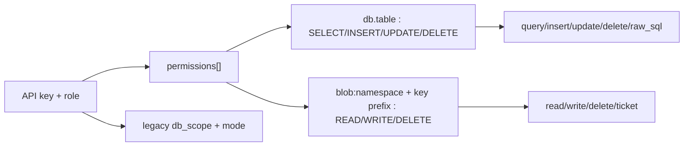

<div align="center">

# MCP reference

**Give AI agents exactly the database + blob powers you grant — nothing more.** Same auth, same RBAC as REST, over JSON-RPC 2.0.

</div>

---

> **Auth model:** `POST /mcp/v1` requires `X-Axiom-Key` (or session Bearer). Tool *discovery* lists all 15 tools, but every *call* re-evaluates `PolicyEngine` — unauthorized calls return `AUTH_FORBIDDEN`.

## Contents

- [Connect](#connect)
- [Database tools](#database-tools-8)
- [Blob tools](#blob-tools-7)
- [Resources](#resources)
- [RBAC mapping](#rbac-mapping)
- [Example session](#example-session)

---

## Connect

```bash
# initialize → tools/list → tools/call (JSON-RPC 2.0)
curl -X POST http://localhost:4500/mcp/v1 \
  -H "X-Axiom-Key: $KEY" -H "Content-Type: application/json" \
  -d '{"jsonrpc":"2.0","id":1,"method":"tools/list","params":{}}'
```

Tool names work with or without the `axiom_` prefix (`query` ≡ `axiom_query`).

## Database tools (8)

| Tool | What it does | Key params | RBAC op |
|---|---|---|---|
| `axiom_list_services` | List accessible database aliases | — | per-DB `filter_databases` |
| `axiom_list_tables` | List tables in an alias | `alias`, `limit`, `cursor` | `SELECT` on alias |
| `axiom_describe_table` | Columns + foreign keys | `alias`, `table` | `SELECT` on table |
| `axiom_query` | Paginated `SELECT` via filter builder | `alias`, `table`, `filter?`, `limit?`, `sort?`, `order?`, `cursor?` | `SELECT` on table |
| `axiom_insert` | Insert one row | `alias`, `table`, `row` | `INSERT` |
| `axiom_update` | Update with mandatory filter | `alias`, `table`, `filter`, `update` | `UPDATE` |
| `axiom_delete` | Delete with mandatory filter | `alias`, `table`, `filter` | `DELETE` |
| `axiom_raw_sql` | Single-statement SQL | `alias`, `sql`, `params?` | per-table, per-statement op |

Rules inherited from REST: **single statement only** (`MULTI_STATEMENT_DENIED`), mandatory filters on update/delete, allowlisted `data_type` on schema changes, generic errors in release builds.

## Blob tools (7)

| Tool | What it does | Key params | RBAC op |
|---|---|---|---|
| `axiom_list_blob_namespaces` | Namespaces visible for READ | — | `filter_blob_namespaces` |
| `axiom_list_blobs` | List keys by prefix | `namespace`, `prefix?`, `limit?` | `READ` |
| `axiom_get_blob_metadata` | Size, hash, content-type | `namespace`, `key` | `READ` |
| `axiom_read_blob` | Read bytes (5 MB MCP cap) | `namespace`, `key` | `READ` |
| `axiom_write_blob` | Write bytes | `namespace`, `key`, `content` | `WRITE` |
| `axiom_delete_blob` | Delete object | `namespace`, `key` | `DELETE` |
| `axiom_create_download_ticket` | Mint ticket (≤ 24 h) | `namespace`, `key`, `ttl_seconds?` | `READ` or `WRITE` |

## Resources

- `axiom://blob/{namespace}/{key...}` — read a blob as an MCP resource (nested keys preserved; only `READ`-granted keys resolve).
- Server info via `initialize`; Prometheus/metrics stay session-only (agents never see them).

## RBAC mapping



- Granular `permissions` win when present; otherwise legacy `db_scope` + `mode` (`readonly`/`writeonly`/`readwrite`) apply.
- Ticket identities (`role=ticket`) can never `DELETE`, even with `WRITE`.
- Sessions (`is_session`) bypass — never hand a session token to an agent; mint a scoped API key instead.

## Example session

```jsonc
// tools/call axiom_query
{ "jsonrpc": "2.0", "id": 2, "method": "tools/call",
  "params": { "name": "axiom_query",
    "arguments": { "alias": "main_db", "table": "users",
      "filter": { "active": { "$eq": true } }, "limit": 10 } } } }

// tools/call axiom_create_download_ticket (clamped to 60–86400 s)
{ "jsonrpc": "2.0", "id": 3, "method": "tools/call",
  "params": { "name": "axiom_create_download_ticket",
    "arguments": { "namespace": "media", "key": "avatars/u1.png", "ttl_seconds": 3600 } } }
```
